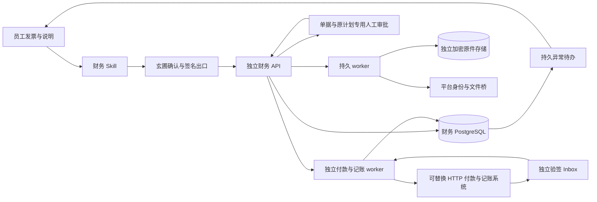

# 财务 F0–F13 当前架构

财务作为进程外 HTTP 服务运行。玄圃负责企业员工身份、会话和工具入口；独立财务服务持有公司授权、导入操作、发票、异常、原件回执及事件。平台进程不加载财务业务代码。当前覆盖F0原件、F1报销/人工审批、F2应付/付款/记账、F3查验/红字/档案、F4提醒/恢复、F5专用资金及F6只读接入准备。当前F13按用户要求聚焦发票申报与内部报销流转记录，不做支付；已有摘要检索、专用profile、公司内部试用检查和停机原件核对，F12补齐收件中途撤权单项隔离、真实崩溃恢复与并发人工确认验收，F13补齐独立原件目录边界及故障恢复后的真人续办。契约finance 0.14.0-f13、77项API、24内部操作、7个Skill；实际制品与门禁以[F13验收记录](../guides/releases/2026-10-23-finance-f13-acceptance.md)为准。真实供应商、正式制度、官方标准和正式归档尚未验收。

以下图包含general模式的可替换外部通道；internal_records不装配外部worker、供应商客户端及回调。

## 数据归属与独立性

财务包、数据库实例/数据库/账号、原件目录或桶、加密密钥、备份及迁移独立于平台。没有跨库外键，没有读取平台数据库或对象存储的凭据。平台只通过受限 HTTP 文件桥提供受权员工的固定文件版本，财务接收后拥有自己的原字节副本。删除平台附件不删除财务副本。企业身份停用仍由平台在线目录核对，平台无法访问时拒绝新业务；独立存储不意味着身份授权离线放行。

财务公司及 collector/reviewer/approver 权限由操作员配置，在财务库持久保存。重启时配置授权集合为准撤销旧授权，不删除历史材料。collector 仅本人公司内记录；reviewer 可见授权公司全部记录，也可补件和取消。平台管理员没有默认财务正文访问权。approver只看本人和实际分派单据/关联证据；内部approval已可用，外部审批及真实ERP/payment/tax/archive仍 unconfigured，未来适配器不能反向拥有核心业务状态。

## 可信执行与受控输入

连接器显式声明 contextAudience，平台操作员按目标 origin 允许 audience。平台出口从持久会话恢复实际员工身份，使用租户保险库中的 Ed25519 私钥签发最长60秒 JWT；签名绑定方法、解码后的路径、query、JSON、幂等键和 Content-Type。财务固定 issuer/audience/kid 公钥目录验签，持久保存 issuer+jti 的主体、摘要与幂等键，复核在线员工和财务公司授权。

文件桥仅接受 file_id、revision、sha256，复用员工文件权限。机器 API key 必须获准 act-as 具体员工；root/machine 原始身份不能替代员工。财务请求体在 FastAPI 解析前限制1MiB，单原件20MiB、单批100MiB/100项。跨租户与无权对象读取失败关闭。

## 持久进度与 HITL

导入先事务持久 accepted 再返回202，逐项状态独立保存。worker 使用数据库租约、心跳和 fencing；进程额外持有独占 advisory lock。持锁连接失效立即禁用旧实例、停止认领并返回不健康；数据库错误不会冒充业务成功。

PDF/OFD/图片保留原件并生成 awaiting_original；未知 XML profile 隔离为 quarantined。解析在可取消的独立子进程限时执行；defusedxml 拒绝外部实体/DTD，不提供操作系统级网络沙箱。本阶段只实现明确命名的合成 XML profile，production 配置禁止 synthetic。字段保留原值、路径和来源回执；主票唯一约束处理重复来源。所有查验字段保持 not_checked/unverified，未配置官方查验。

HITL 在 F0 体现为财务库内的持久异常，补件请求必须同时携带 source_exception_id、expected_exception_version 及新文件固定引用。成功解析后同事务链接旧/新证据并关闭原异常，失败保留原待办。服务/会话重建不会丢失待办。材料补齐和平台工具确认均不等于财务业务审批；F1在同一独立库持有真实顺序审批、人工决定与撤回/驳回，不把工具批准转换为业务决定。

## 运行模式与恢复

启动时选择 enabled、draining、read_only 或 disabled；配置改动需重启。draining 拒绝新导入而允许处理已受理项及取消；read_only 保留读接口、暂停导入worker；disabled 拒绝员工业务接口、保留数据。F2外部查单和验签回调在后三种模式仍运行，均禁止新发送。取消仅取消未完成项，已提交票据/原件不删除。

本地和 S3 适配器均以 AES-GCM 保存密文、固定 key 不允许换内容覆盖；这不是经过认证的 WORM。独立备份必须同时保全数据库、原件和加密密钥。对象/数据库间故障的恢复证据见验收记录，不能以 HTTP200 或测试模拟声明生产已验收。

## F1 轻量记录与人工入口

费用记录持久保存record_mode及每次版本快照；internal_record允许没有结构化发票，仍保留附件缺口与not_checked语义。配置未提供时禁用新报销；显式最小分类和真实审批人即可启用，制度版本不可覆盖。invoice_backed或任何有分票的记录必须完整分配，提交锁单据和排序票据，原子复核票/行金额税额累计。批准后额度仍reserved，未进入支付/核销。

平台通用人工HTTP网关只接受当前员工cookie+CSRF，拒绝API key、root和act-as，校验租户已安装包及显式工具列表。HumanContextSigner在最终请求中签origin=human与interactive关联；模型路径固定agent。财务executeFinanceAction要求人工来源、当前身份/公司授权与计划/目标/步骤/策略版本同时有效。模型故障时功能辅助页仍可操作。

预检不产生决定。单据/Workflow/Step/Decision/幂等Operation/额度/事件/Outbox同事务。中间审批只递增流程和步骤版本，最终批准/驳回/撤回改变单据版本；待办由财务库恢复。超时与策略变更阻断批准，允许有权申请人新计划撤回清理。策略实际启停或更改的generation进入计划和工作流，恢复旧版本不复活旧授权。通知Outbox由F4消费到独立财务站内inbox，不代表外部渠道已送达。

企业微信/飞书是未来可替换适配器，内部ID、原件和审批历史保持财务所有；单一流程权威和外部映射/回调验签须在接入时显式实现。当前只支持internal provider。[F1使用指南](../guides/finance-f1.md)描述启用步骤。

## F2 专用批准及外部状态

应付复用有document_kind区分的版本单据和顺序业务审批，旧报销API拒绝访问应付。供应商/合同/订单/验收和收款账户来自受控目录，版本和摘要冻结入计划。internal_record始终不能进入付款或记账。正式发票要求有效查验；隔离模拟显式使用finance_test库、独立原件前缀及持久simulation标记，既有F1单据不自动升级。

execute_payment、submit_posting、reverse_posting生成不可变计划及独立action_plan审批流程。实际分派审批人批准同一digest，原经办再人工确认；付款/记账岗位分离，申请人和经办不能自审。专用授权绑定金额、目标、策略/岗位/目录/渠道代数及有效期，停用再恢复旧配置不复活授权。

独立settlement worker在发送前核对所有实际批准人的在线状态与当前授权，在财务事务保存dispatching及固定请求；网络不持有数据库事务。固定HTTP渠道支持幂等和查单，缺任一能力即关闭。受理/在途/未知分别持久化；未知保留占额，自动退避查单及人工reconcile均只GET原请求号。恢复、停发及锁丢失不能再次POST。

付款与凭证各自计额，部分成功不核销整张分配；冲回引用原凭证、独立批准并保留历史。成功证据必须匹配所有固定范围，原字节及哈希与状态同事务保存；错误回执保全后为未知。回调使用独立HMAC、固定配置密钥和持久inbox，重复事件幂等、异内容冲突，合法回调只唤起查单。外部异常独立于F0导入异常表，统一查询但不能人工宣称付款成功。Outbox经F4进入独立站内提醒，外部通知适配器尚未接入。

F2阶段提供38项工具及6个Skill，模型可准备/查询，人工网关执行；独立辅助页支持应付、脱敏账户、专用待办、付款/入账/冲回和结果核对。协议及配置见[F2指南](../guides/finance-f2.md)。

## F3 税务与归档独立闭环

F3使用自己的typed target计划/流程/实际决定/grant/operation/receipt/inbox与查验、红字、调整、档案、审计及补包表，不依赖伪报销父单据。FinanceStore统一API按f3plan_/f3op_派发。票面content版本不变，ComplianceState独立版本；F1/F2/F3共用实时金额与正交状态投影、同一排序蓝票锁和授权代数。

ComplianceQueueAdapter复用SettlementWorker心跳/发送门禁/只读恢复，第三后台随实例锁丢失一同取消。preflight取证网络暂不可用保留未发送任务；任何dispatching之后未知只查原请求。税务当前源以provider/config/generation隔离权威revision，旧来源仅留证，当前策略立即收紧TTL，原passed观察时刻不被pending刷新。

ArchivePipeline先物化独立加密固定ZIP，随后事务重检再首次上传。通用档案HTTP要求全部内容/manifest/seal的实际字节、具体版本和保留锁逐项读回；seal包含真实sealed_at，保留期限按受控起算规则核对。成功恢复和只读审计共用全量验证，不信succeeded/readback_verified字符串。正式profile当前拒绝，仅显式simulation协议验证。

档案源闭包包括关联蓝红票实际原件/字段/明细/查验、费用与支付凭证、实际F3税务人工决定、调整义务及人工补件。失败原始回执按raw evidence字节保留。归档/审计自身未来回执不进入本包源。历史封存事实、清册、检测与决定不可变；实际事件sequence及关联单据变化产生补包缺口，补包绑定父hash及来源事件，审计失败只追加健康记录。

F3阶段发布58操作/7Skill。模型可准备和查询，执行、红票关联和调整人工补件只走真实human；直接财务辅助页仍独立于模型。完整配置、固定HTTP协议、数据所有权与真实能力边界见[F3指南](../guides/finance-f3.md)。F4已将相关统一查询收敛到SQL授权过滤、独立count与同快照稳定分页，生产规模查询计划仍须实测。

## F4内部收敛与恢复

F4阶段包61操作/7Skill。独立财务库保存原生通知和读状态，旧Outbox消费到inbox_recorded，当前审批/期限/未知/档案健康按真实源版本去重；当前授权及来源过滤列表与计数，已读不批准、消息不执行。通知任务不依赖模型，实例锁丢失取消四任务。未接外部通知，财务提醒不与平台通用通知正本混存。

F3及统一F2/F3查询在SQL做授权count与limit+1分页；同一repeatable_read快照。listIntegrations反映真实持久配置阶段，reviewer概览只公开公司聚合，最早活动时间排除终态，通知统计排除已失效来源。

维护CLI用成熟pg_dump/pg_restore与同一独占锁，配套local密文/清册HMAC/责任索引AAD认证；维护丢锁禁止发布，恢复只新空库和新对象根，不启动worker或覆写当前配置。S3版本备份、外部档案灾备及生产异机指标未验收。[F4指南](../guides/finance-f4.md)与[缺口台账](../guides/finance-gap-register.md)界定该阶段范围，F5专用资金见下节。

## F5专用资金与原件责任

`document_kind=funding_case`在独立财务库复用版本单据、顺序审批、行动计划与F2队列。五种严格场景为无票预付、员工已付款后的本人偿还、供应商授权第三方收款、已付预付核销、真实材料退款核对；后两者不能再次付款。委托保持原发票销方，不处理客户代收款。核销实际消耗发票分配；退款为内部人工事实，不发起银行退款或宣称到账。父子累计预留/完成不超过确定已付，unknown不算已付；最后批准的收尾事实不可普通撤回。

`importSupportingMaterials`复用F0收件、固定文件版本、责任索引及AES-GCM独立副本，以`purpose=supporting_material`持久化；逐项`material_received`与source证据`not_checked`不等于材料验真，也不制造发票或缺票异常。同一原凭据hash与稳定自然scope共享额度，供应商自然键仅kind/source/id，完整版本摘要进入不可变正文，预付合同保留原版本绑定。

`FundingPolicy`必须显式配置五种场景非空链，依赖启用的invoice_backed基础制度与当前实际岗位。独立版本/digest/generation及角色epoch进入计划、业务批准与发送前复核；撤权再恢复不复活批准、单据/计划/支付/票据分派读权。员工仅绑定本人受控employee_account，委托固定原指定supplier_account。getFundingOptions展示五链和当前可见已核实脱敏账户，listPayeeAccounts按场景筛选；渠道token不返回。getFundingMaterial仅向当前有权owner/reviewer/epoch有效分派人按块读取本单据关联独立原件；服务整体hash核对，人工页合并分块后再次校验再下载，模型不持有base64读取工具。日期授权按Asia/Shanghai自然日含末日判断。

人工动作沿真实cookie/CSRF/origin签名网关；模型可起草、分配、预检和查询，不可executeFinanceAction或revokeFundingAuthority。外部通道须显式supported_funding_scenarios，缺省空不扩权；空能力描述符保持旧hash。发送前再次重审资金制度/原件/账户/授权/实际批准人，沿F2首次一次POST和unknown原号GET，重启或撤权不重发。

F3归档闭包扩展funding_case父子、实际材料、authority/decisions/reservation与付款/记账原回执；新源事实追加事件并要求补包。成熟pypdf/Pillow在可终止进程（10秒期限）进行PDF/PNG/JPEG有限结构检查，限制50MiB/2000页/2000万像素；不证明官方签章或法定四性。F4提醒保留资金目标，funding_due仅确定已付、到票逾期未结的预付，完整收尾后退出。SQL授权count/分页和独立dump/新库恢复覆盖新事实，恢复不启动worker。

专用场景的配置、严格字段、API示例及停发续办见[F5指南](../guides/finance-f5.md)。正式制度/供应商未选，仍仅simulation与可替换HTTP；真实税务票样/WORM/外部报销/异机DR/真实模型与生产并发未验。

## F6接入准备与验收事实

`--preflight`在启动前只读显式固定凭据，检查秘密格式/权限/分离、公司制度与渠道前提，不连接外部资源或迁移。`getFinanceReadiness`仅当前同公司reviewer可读，从独立PG的read-only repeatable_read事务读取实际当前配置、授权代数及账户/渠道启停；配置摘要绑定作用域与版本。运行态独立附带模式、锁和后台任务故障。报告不持久化为批准，不新增业务表或平台库外键；逐单预检/HITL/原经办执行不受检查结果替代。

仓库固定验收入口验证loopback实际finance_test库，使用真实pytest/JUnit生成模块覆盖/失败/跳过/源码和证据摘要。临时两库/独立非超级角色双向CONNECT拒绝是隔离机制演练，不代表正式凭据或原件IAM已验。正式制度批准、供应商、官方票样/签章、WORM、异机DR、模型与生产负载始终not_verified，关闭条件见[正式接入清单](../guides/finance-provider-acceptance.md)。

## F7 内部记录使用闭环

ExpenseDraft可选invoice_information仅在internal_record原样保存，作为未查验的用户申报，不能写正式发票或取得执行资格。listExpenseClaimHistory按当前普通报销读权分页读取finance_expense_history与finance_decision不可变原文；不把最新workflow反推旧意见。getExpenseMaterial仅接受human，校验当前岗位代数及指定版本实际证据关联，再从独立加密存储验证完整字节摘要返回固定分块；原件下载不是验真，awaiting_original已保全材料仍保持原状态。

F7复用既有本人确认、顺序审批、驳回补充重提、撤回与持久待办，审批通过即内部流程完成；不引入支付或独立结案状态。API及人工页共用规则，Skill仅准备草稿/计划及查询历史，原始附件读取与业务决定保留人工入口。F7不需要供应商配置。

## F8 收件目录与实际使用

独立PG原有operation/item/receipt建立本人材料目录，不新增平台业务表。两个只读API逐次核当前租户、公司、owner和用途；count/items同repeatable_read，复合倒序游标绑定完整范围。逐项回执责任链决定selectable，整体partial或cancelled不抹去已保全项；元数据不代替实际原件完整性验证。

人工页提供已收件附件选择与持久收件列表。localStorage仅为受限恢复线索，平台POST前保全原request_id，财务POST前保全固定ref与原key；未知人工恢复、known op只读，损坏或存储失败拒绝发送。内联选择保留当前未保存内容，整页刷新不承诺恢复正文。服务端仍是状态、权限和责任链依据；HITL计划与实际真人执行边界不变。

## F9 内部记录专用实例与摘要

`profile=general`保持已有通用接口和回归，`profile=internal_records`是显式受限部署形态，与enabled/read_only/disabled/draining正交。配置必须有公司、enabled/internal_record制度和实际collector/审批岗位，拒绝模拟、未填写标识及外部策略/供应商/目录/账户。进程取得独占锁后，先以只读repeatable_read检查整个实例全部租户：非内部报销、正式发票、结算/合规操作、非supporting_material导入（含未生成invoice的accepted/running）、非内部动作计划、启用的外部策略/供应商或simulation均阻断。空库允许首次迁移；未知旧结构拒绝，不为通过检查删除或重写旧业务。

内部profile只登记内部收件、普通报销、真实审批/提醒及只读overview的明确操作白名单；不装配结算/合规注册表、客户端、worker和回调。preview/getPlan/execute另校验实际计划的expense_claim目标及submit_claim/approve/reject/withdraw动作，旧计划不能借共享入口越界。human来源、当前身份/公司授权、版本、策略代数、CAS和幂等均继续生效。

`getFinanceCapabilities`在可信员工认证后仅返回profile/mode/service_version/internal_records_only，不代表个人权限、ready或批准。页面与所有Skill先读能力；内部模式隐藏通用功能并限制业务引导，服务端白名单仍是执行边界。读取失败或元数据非法不能静默按general处理。

`listExpenseClaimSummaries`用显式SQL投影九个字段，不组装完整快照。当前tenant/company/owner、reviewer或历史分派权限过滤，mine额外限定owner，默认20最大50条；事由/单号字面忽略大小写检索，游标绑定完整身份和筛选，created_at/id倒序；count/items同一repeatable_read。旧详情/历史接口仍保持完整事实。页面过滤切换使旧异步结果失效，pending写/收件恢复规则不变。

专用离线预检只读固定凭据文件，不连接数据库/网关、不创建对象目录或worker，不要求外部支付/ERP/档案能力。所有检查通过仍not_verified，不能替代实际部署、人员制度、网络权限或备份恢复验收。填写与运维步骤见[F9指南](../guides/finance-f9.md)。

## F10 内部试用核对

getInternalRecordsReadiness仅internal_records实例、当前公司reviewer可读。授权与公司/制度/grant-epoch在同一readonly repeatable_read快照；外部启用指针直接查询，孤立revision也阻断。制度合法JSONB若非object被明确视为失效配置，原值仅参与摘要，不回显。查询故障正常失败，不能报告部分成功。

固定12项检查和有限runtime不含正文/账号/税号/路径/密钥，全部通过仍not_verified。receipt与notification任务须实际运行、实例锁有效且无外部worker/registry。health覆盖通知错误和锁丢失；HTTP200不构成业务或上线验收。页面只主动读取，无自动轮询、配置写入、批准或上线操作。

恢复使用同公司/grant/制度及密钥配置，单独替换DSN/原件根与mode；read_only仍允许启动迁移/配置注入及签名重放记账，只限制业务写命令。对比恢复前后摘要、授权代际、历史与真实原件，不把注入新配置当纯恢复。撤权恢复不复活旧分派或批准计划；依当前状态由申请人撤回重提、重新人工决定。见[F10指南](../guides/finance-f10.md)。

## F11 正式启动门禁与停机原件核对

production/internal_records在任何数据库连接、迁移、配置注入、HTTP客户端或对象构造前复验配置及固定凭据。安全文件读取仅捕获一次，池和独占锁共用同一DSN，身份令牌、公钥、AES和S3构造全部使用已验快照；轮换后须重启。门禁复用离线预检的文件权限、大小、类型、密钥、令牌分离、租户映射及HTTPS规则。结构检查、离线检查通过和服务构造分别只能证明各自层次，不能替代正式身份、网络、IAM或部署验收。test/development及general保留现有行为。

独立维护verify只接受local原件、public schema且已初始化的内部记录库。停机时取得与运行互斥的独占锁，在只读repeatable_read事务内检查兼容结构及实际AES原件。结束前复核锁；缺失必须原件、篡改、活动实例或不兼容库均失败。prepared缺件或未映射密文返回incomplete和计数；报告不带对象键、文件名或正文。空库无表拒绝，已初始化零对象可完成但不能证明密钥正确或存储可写。此入口不迁移、建目录、写业务、调用备份工具、启动模型/任务或写回就绪报告。

API仍77项，内部开放24项，7个Skill不增加维护命令或shell权限。HITL继续真人预检和确认，approved仅表示内部审批；不执行支付。服务/镜像2026.10.23.2，人工页面行为未变，版本保留2026.10.23.1。见[F11指南](../guides/finance-f11.md)。

## F12 内部收件中途撤权与故障恢复验收

内部材料的prepare_original/receive_original检查点在各自事务内复核公司授权，与撤权通过现有角色行锁排序。worker只把明确COMPANY_FORBIDDEN落为当前项失败；保留已写责任索引、密文和回执，不把失败材料标成功，不删除历史。其余数据库错误及失租约仍按原语义传播，避免把存储故障伪装为权限拒绝。恢复授权不自动重试失败项，须按当前资格核对后补充或重提。该收件隔离结论限定internal_records支持材料；未扩大通用票据解析结束阶段的错误策略。

F12实际强制退出验收以PG测试屏障停在原件写完而回执事务未提交处，产品CLI SIGKILL后从prepared责任索引和独立密文续办，等待持久60秒租约自然到期；不改产品租约或注入测试接口。真实并发人工确认和抑制已提交HTTP响应的测试复核同计划/同键/换键仍返回原operation，竞争决定不重复。具体结果以F12验收为准，不推导掉电、写中损坏自动恢复、异机RTO/RPO或生产负载合格。

仍为77 API、24内部操作、7 Skills；没有新表、新状态或页面。业务包0.13.0-f12，finance/镜像2026.10.23.3，console保持2026.10.23.1。Skill只核对原请求和持久事实，不能重建或代发人工批准。见[F12指南](../guides/finance-f12.md)。

## F13 独立原件目录边界与真人续办

本地原件IO由LocalObjectFiles使用POSIX目录描述符和相对名字完成。每次安全打开root/shard，拒绝根、分片目录与叶子的符号链接及非目录路径；叶子先不跟随链接stat，再以O_NOFOLLOW/O_NONBLOCK打开并fstat，只接受普通文件。新密文在已打开分片内以O_EXCL创建私有临时文件，关闭后以相对硬链接原子创建最终项；已存在只安全读取并交原AES/AAD及内容比较，不覆盖旧原件。只清理本次成功创建的临时项并关闭描述符。XF01格式、哈希布局、缺件/认证/不变性语义及S3适配不变。

静态不安全路径返回OBJECT_PATH_UNSAFE/500且不含路径或正文；其它真实IO错误继续传播，竞态不承诺都返回同一码。内部收件沿既有规则记录OBJECT_STORAGE_FAILED，不把密文存在当材料成功。合法真人读取被拒绝时，除了真实签名认证的防重放记账，不能借故障改变收件、审批或业务事实。受信管理员核对独立目录并恢复合法文件后，查询原operation，依当前资格补充或续办；模型不能删除文件、替换链接、读取原件正文、执行维护或批准。

支持macOS/Linux的POSIX dir_fd/O_NOFOLLOW；必需能力不足时失败关闭。配置根目录祖先必须受信，服务账号与受信运维独占根/分片/临时项修改权。已经打开的目录被改名后，操作仍可能通过旧fd成功，但不会跟随新植入链接；这不证明当前配置路径仍可达，也不提供自动修复。恶意本机管理员、硬链接、挂载更换、主机掉电、写中残留临时文件自动修复、Windows、真实生产存储与灾备均不在本轮安全/验收承诺内。Linux另有基础文件IO演练，不能等同整套Linux验收。

业务包0.14.0-f13、finance/镜像2026.10.23.4，console保持2026.10.23.1。77 API、24内部操作、7 Skills、shell=false和工具名单不变；无新页面行为。本轮CLI/签名HTTP联合证据不作为浏览器验收。详见[F13指南](../guides/finance-f13.md)。
