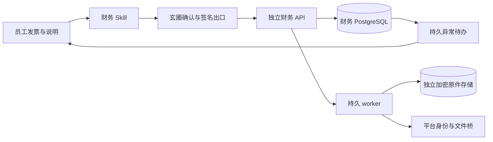

# 财务 F0/F1 当前架构

财务作为进程外 HTTP 服务运行。玄圃负责企业员工身份、会话和工具入口；独立财务服务持有公司授权、导入操作、发票、异常、原件回执及事件。平台进程不加载财务业务代码。当前交付F0原件归集与F1轻量报销记录、持久人工审批；支付、ERP和正式归档仍在后续阶段。

## 数据归属与独立性

财务包、数据库实例/数据库/账号、原件目录或桶、加密密钥、备份及迁移独立于平台。没有跨库外键，没有读取平台数据库或对象存储的凭据。平台只通过受限 HTTP 文件桥提供受权员工的固定文件版本，财务接收后拥有自己的原字节副本。删除平台附件不删除财务副本。企业身份停用仍由平台在线目录核对，平台无法访问时拒绝新业务；独立存储不意味着身份授权离线放行。

财务公司及 collector/reviewer/approver 权限由操作员配置，在财务库持久保存。重启时配置授权集合为准撤销旧授权，不删除历史材料。collector 仅本人公司内记录；reviewer 可见授权公司全部记录，也可补件和取消。平台管理员没有默认财务正文访问权。approver只看本人和实际分派单据/关联证据；内部approval已可用，外部审批及ERP/payment/tax/archive仍 unconfigured，未来适配器不能反向拥有核心业务状态。

## 可信执行与受控输入

连接器显式声明 contextAudience，平台操作员按目标 origin 允许 audience。平台出口从持久会话恢复实际员工身份，使用租户保险库中的 Ed25519 私钥签发最长60秒 JWT；签名绑定方法、解码后的路径、query、JSON、幂等键和 Content-Type。财务固定 issuer/audience/kid 公钥目录验签，持久保存 issuer+jti 的主体、摘要与幂等键，复核在线员工和财务公司授权。

文件桥仅接受 file_id、revision、sha256，复用员工文件权限。机器 API key 必须获准 act-as 具体员工；root/machine 原始身份不能替代员工。财务请求体在 FastAPI 解析前限制1MiB，单原件20MiB、单批100MiB/100项。跨租户与无权对象读取失败关闭。

## 持久进度与 HITL

导入先事务持久 accepted 再返回202，逐项状态独立保存。worker 使用数据库租约、心跳和 fencing；进程额外持有独占 advisory lock。持锁连接失效立即禁用旧实例、停止认领并返回不健康；数据库错误不会冒充业务成功。

PDF/OFD/图片保留原件并生成 awaiting_original；未知 XML profile 隔离为 quarantined。解析在可取消的独立子进程限时执行；defusedxml 拒绝外部实体/DTD，不提供操作系统级网络沙箱。本阶段只实现明确命名的合成 XML profile，production 配置禁止 synthetic。字段保留原值、路径和来源回执；主票唯一约束处理重复来源。所有查验字段保持 not_checked/unverified，未配置官方查验。

HITL 在 F0 体现为财务库内的持久异常，补件请求必须同时携带 source_exception_id、expected_exception_version 及新文件固定引用。成功解析后同事务链接旧/新证据并关闭原异常，失败保留原待办。服务/会话重建不会丢失待办。材料补齐和平台工具确认均不等于财务业务审批；F1在同一独立库持有真实顺序审批、人工决定与撤回/驳回，不把工具批准转换为业务决定。

## 运行模式与恢复

启动时选择 enabled、draining、read_only 或 disabled；配置改动需重启。draining 拒绝新导入而允许处理已受理项及取消；read_only 保留读接口、暂停 worker；disabled 拒绝业务接口、保留数据。取消仅取消未完成项，已提交票据/原件不删除。

本地和 S3 适配器均以 AES-GCM 保存密文、固定 key 不允许换内容覆盖；这不是经过认证的 WORM。独立备份必须同时保全数据库、原件和加密密钥。对象/数据库间故障的恢复证据见验收记录，不能以 HTTP200 或测试模拟声明生产已验收。

## F1 轻量记录与人工入口

费用记录持久保存record_mode及每次版本快照；internal_record允许没有结构化发票，仍保留附件缺口与not_checked语义。配置未提供时禁用新报销；显式最小分类和真实审批人即可启用，制度版本不可覆盖。invoice_backed或任何有分票的记录必须完整分配，提交锁单据和排序票据，原子复核票/行金额税额累计。批准后额度仍reserved，未进入支付/核销。

平台通用人工HTTP网关只接受当前员工cookie+CSRF，拒绝API key、root和act-as，校验租户已安装包及显式工具列表。HumanContextSigner在最终请求中签origin=human与interactive关联；模型路径固定agent。财务executeFinanceAction要求人工来源、当前身份/公司授权与计划/目标/步骤/策略版本同时有效。模型故障时功能辅助页仍可操作。

预检不产生决定。单据/Workflow/Step/Decision/幂等Operation/额度/事件/Outbox同事务。中间审批只递增流程和步骤版本，最终批准/驳回/撤回改变单据版本；待办由财务库恢复。超时与策略变更阻断批准，允许有权申请人新计划撤回清理。策略实际启停或更改的generation进入计划和工作流，恢复旧版本不复活旧授权。通知Outbox当前待派送，不代表已通知。

企业微信/飞书是未来可替换适配器，内部ID、原件和审批历史保持财务所有；单一流程权威和外部映射/回调验签须在接入时显式实现。当前只支持internal provider。[F1使用指南](../guides/finance-f1.md)描述启用步骤。
