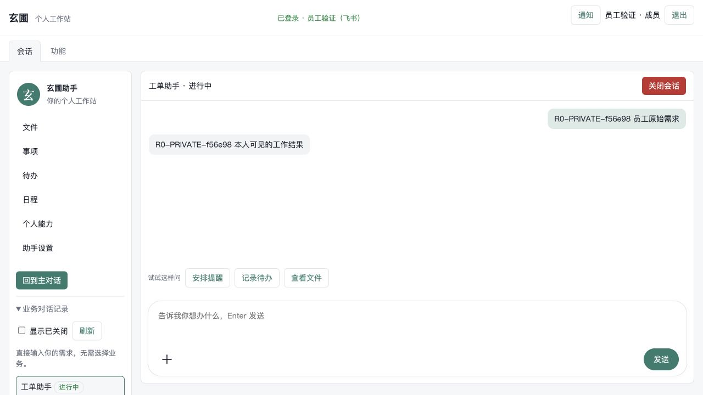
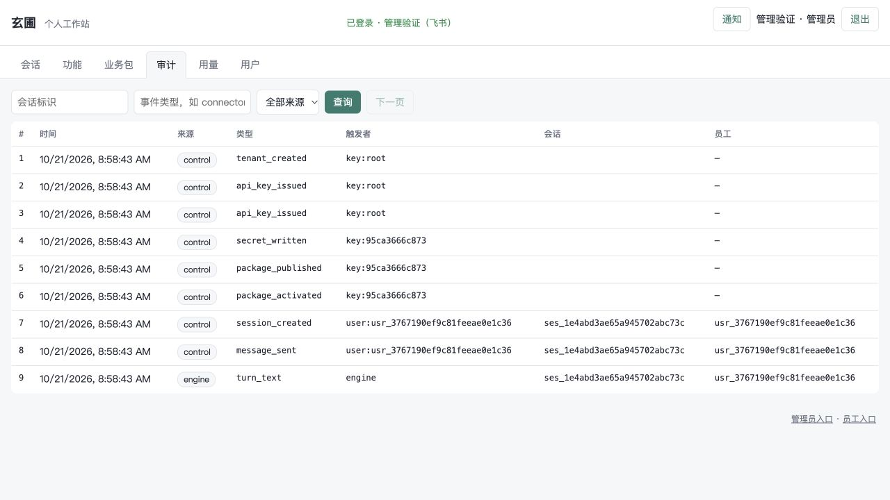

# R0 基础加固验收（2026-10-21）

状态：R0 实施与本地候选验收完成；源码合入本地主线后再次执行全量门禁。
范围仅 R0，不含 R1 企业办公能力扩展，不涉及生产部署。

## 已实现的行为

| 能力 | 实施与限制 |
| --- | --- |
| 内容权限 | 管理元数据与本人内容分离；history/events/pending/messages/resume/assistant 都检查本人；无员工主人的服务会话仅原创建 key 可读写 |
| 管理审计 | 固定元数据白名单，省略任意 data；原始底账保留；SDK data 缺省 None，控制台不渲染正文 |
| 审批幂等 | 0009 持久回执按租户、会话、request_id 整组认领；同决定回放原 submission；不同决定、重叠、处理中或未知结果返回409，附 operation_id/state/submission_id |
| 故障语义 | 核销回执与审计同事务；拒绝清理中断可恢复；回调落库异常不杀事件枢纽；未知写结果、审计故障均不能触发模型自动重试 |
| 取消 | 覆盖冷准备，提交前复核主人与停止意图；requested/unconfirmed 不伪装已停止；内核保留挂起选项消除转挂起清除待办的竞态 |
| 中止 | 根系统 abort 的 resolved.aborted=True 明确结束流，不记成功或额外一轮模型用量 |
| 单实例 | PostgreSQL 独立连接持咨询锁；试用目录文件锁；第二进程启动前被拒绝；丢锁停接单、取消准备并关后台；清理失败保留持有权直到进程退出 |

回执 applied 只表示审批决定已核销。咨询锁不是存储 fencing，正在执行的外部调用可能完成，
本轮不承诺任意外部系统严格一次执行。

## 当前证据

| 层次 | 证据 |
| --- | --- |
| 原始基线 | d3ce51f，1593 passed / 3 skipped，见[基线](2026-10-21-r0-baseline.md) |
| 最终平台 | PyPI 正式依赖安装后 **1653 passed / 3 skipped，128.47秒**；Ruff通过，mypy **142模块**，锁文件检查 **103包** |
| 内核 | 4029 passed / 17 skipped；38/38模拟示例；Ruff、mypy 308模块；wheel/sdist在全新环境安装与公共接口检查通过 |
| 数据库 | 实际临时PostgreSQL，含迁移、并发认领、租户隔离、回执与审计回滚、双操作系统进程争锁、锁连接终止后HTTP503与任务退场 |
| Linux连接器 | Docker backend新回归4 passed：重复批准、并发批准、超时与审计故障，真实MCP副作用各仅一次；没有用skip替代 |
| 浏览器 | 员工读取本人正文，管理员审计只见元数据，PRIVATE标记不出现；测试身份直接签发本地cookie，不代表真实飞书OAuth验收 |
| 真实模型与PostgreSQL | 三条平台流程通过：会议信息澄清、确认草稿且重复确认只建一条日程、主动跟进→站内提醒→完成；外部通知0 |
| 内核真实模型矩阵 | Codex Responses 方言 **34/34通过**；先前 Chat 失败记录已保留，未计为通过 |
| 平台镜像 | Linux/amd64 本地构建成功；164个安装文件与验收源码哈希一致；新库迁移至0009及重复迁移通过；第二实例退出码3，首实例退出后新实例健康；临时资源全部清理 |
| 生产部署 | not_checked，本轮未部署、未切流量 |

本轮直接执行的主要门禁：

```bash
uv run pytest -q -rs
uv run ruff check --select F,S108,I,TC packages scripts/runtime_inventory.py
uv run mypy packages/*/src
uv lock --check
```

早期候选曾使用本地内核 wheel，最终验收已从发布源重新安装正式版本，分布无 direct_url 覆盖。
3个平台skip是memory参数不适用的数据库专项，其PostgreSQL变体已跑；内核17个skip为旧v1事件金样，
当前v2契约已变更，需要另外重录，不能当作17项已验证。

## 交付身份与发布范围

- 玄圃 server、CLI、SDK、console：`2026.10.21.1`；spec 保持 `2026.10.2.7`。
- 泰逢：`2026.10.1.11`，最终源码 `4e1a4fa`，已发布 [PyPI](https://pypi.org/project/taifeng/2026.10.1.11/)。
  [GitHub CI](https://github.com/LumoraX/taifeng/actions/runs/39525671854) 与
  [发布流水线](https://github.com/LumoraX/taifeng/actions/runs/39525675450) 均成功；真实模型台账对应实现 `304996f`。
- sandbox、stores：保持 `2026.9.29.15`，源码分别 `abfed41`、`086f212`，未修改发布。
- 本地镜像 `xuanpu-r0:2026.10.21.1`，未推送远端；ID 为
  `sha256:69b54e88bea7c07513f7cd51d6523dd030ef548a21cbc3c5c2e09daa3c6a24de`。
  [结构化镜像回执](evidence/r0/image-verification.json) 记录包版本、源码清单摘要与启动结果。
- 开发环境 Python 3.13.9；生产环境未读取、未部署、未切换版本。

已发布内核将部分审批重复核销、保留挂起的取消和根系统中止结果纳入公开契约。
普通人工审批重复 request_id 明确拒绝；内部过期哨兵仅处理尚未核销项目，保留既有语义。
本地镜像启动采用单进程 `xuanpu serve --config /run/xuanpu/config.json`，不开放多 worker。

## 浏览器证据

员工本人历史：



管理员审计元数据：



真实平台回执：[JSON](evidence/r0/real-platform.json)。真实模型输入仅使用虚构测试事实。
未通过的Chat矩阵：[原始结构化回执](evidence/r0/kernel-chat-failed.json)。该网关的Chat路径拒绝部分
系统消息且图片有错误，不能把它标成R0真实模型全通过；R1应使用已实际验收的协议配置。

## R1 必须继承的边界

- 生产单实例；不开放横向接管、多worker、跨实例配额承诺。
- 不开放管理员默认正文读取或未授权调查取证；代员工调用维持显式授权和双actor。
- 不自动重发未知写结果。批准后直接执行工具若再次挂起，当前内核返回turn_failed(SuspendSignal)，
  不创建新的unknown待办；平台保留未知回执并阻止重复批准。本路径的自动补结果与自动恢复关闭。
- relaxed直接写超时则正常挂起tool_outcome_unknown等待核实。任何外部结果都不能由“取消已受理”推断。
- 真实飞书应用、外部ERP/邮箱授权以及生产升级均不在本轮验收证明里。

## 升级与回退

停旧服务后迁移0009，再启动唯一新服务。0009只加回执表，不删除旧数据；禁止通过删表清理
未知操作。回退旧程序前先停写，保留回执表和原始审计。原始说明见[运维](../operations.md)。
