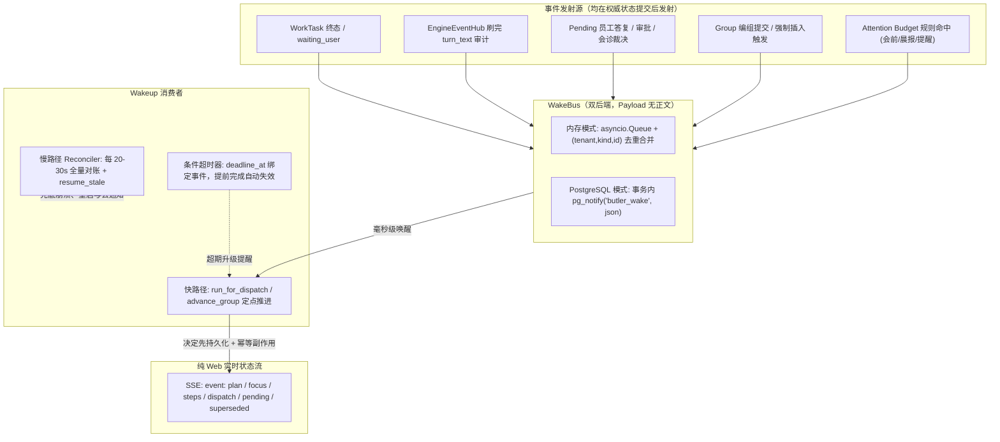
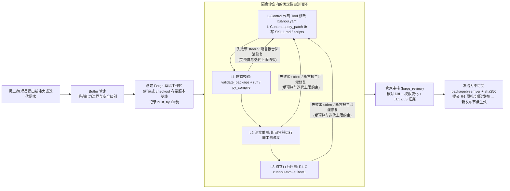
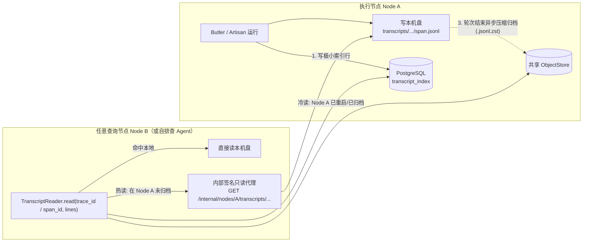

# 玄圃管家运行时底座、造匠自进化与跨节点可观测规划

> 制定时间：2026-11-27  
> 适用范围：`xuanpu` 平台层（`butler`、`runtime`、`packages`、`capabilities`、纯 Web 极简入口）与 `taifeng`（`2026.11.26.0`）稳定内核协同  
> 配套主规划：[玄圃管家核心目标、素养体系（SOUL）、系统架构与演进规划](2026-11-26-butler-soul-and-evolution-plan.md)  
> 关联文档：[管家活文档](../../architecture/butler.md)、[ADR 0017（管家—匠人编排）](../../decisions/0017-butler-artisan-orchestration.md)、[ADR 0020（管家常在线）](../../decisions/0020-butler-always-online.md)、[能力目录与安装契约](../../architecture/capability-delivery.md)、[业务包规范](../../architecture/package-spec.md)、[内核对接口缺口清单](../../architecture/kernel-seam-backlog.md)

---

## 一、规划定位：与 `Butler SOUL` 主规划的协同分工

本规划与 [2026-11-26-butler-soul-and-evolution-plan.md](2026-11-26-butler-soul-and-evolution-plan.md) 构成**“灵魂业务层 × 工程底座层”**的完整闭环，二者不互相覆盖，而是按同一套 M1–M4 节奏咬合推进：

| 规划文档 | 核心回答的问题 | 关键落点 |
| --- | --- | --- |
| **SOUL 与演进主规划（11-26）** | 管家「是谁、怎么想、怎么对主人说话、能做什么生产力交付、如何防业务反噬」 | 6 项 SOUL 素养与 `InstructionLayer` 静态注入、FIFO 顺序队列 + 三阶段强制插入合并、`event: plan` 与末轮分离、唤醒轮缩权防二阶注入、`prev_profile` 真撤回、`document-skills` + `doc-analyst` + 有界动态接力、Attention Budget、双层富呈现 |
| **本规划：运行时、造匠与可观测底座（11-27）** | 平台「如何零轮询事件驱动、如何安全改文件与控制面、管家如何造/测/发新匠人、系统如何三层版本化随时回退、如何完整保留本地 Transcript 且全节点可查以支撑未来自排查」 | 事件驱动唤醒（`PG NOTIFY` + 低频 Reconciler）、统一安全 Hook 链与三层修改边界、文件引擎与跨匠人只读文件接力、管家造匠（Artisan Forge）与 L1/L2/L3 不可变发布节点、本地 Transcript 落盘与跨节点透明检索、纯 Web Aux Pane |

### 参考架构吸收原则（Clean-Room 工程取舍）

综合对 **Claude（Agent SDK / Code / Cowork）**、**Antigravity（AGY 2.0）**、**DeepSeek Harness（`dsh` / Cordis）** 与 **Super Agent（Router–Worker）** 四套体系的洁净室架构对比，确立四条明确取舍：

1. **吸收事件驱动与轻量路由拓扑**：借鉴 Antigravity **Reactive Wakeup + 条件定时器** 与 Super Agent **Router–Worker 分离**（Butler = 轻量常在线路由大脑，Artisan = 隔离重型执行体），消除纯轮询延迟。
2. **吸收强 Hook 安全链与精准补丁闭环**：借鉴 Claude **`Hooks → Deny → Ask → Allow`** 顺序与 `Edit-Test-Fix` 闭环，以及 Antigravity `PostToolUse` 自动校验和 `Artifact` 分层——且优先直接装配 `taifeng` 稳定层已内置的 `HookRegistry`、`make_apply_patch_tool` 与 `PinnedStateRegistry`。
3. **吸收 Creator Mode 与干净卸载，升级为企业级三层不可变发布节点**：借鉴 DeepSeek Harness 的自建能力与 **Cordis Clean Unmounting（卸载/切版零残留）**，但**绝不做单机进程内热覆写**，而是结合 `xuanpu` 现有的 `PackageRegistry` 与 R4-C 不可变快照，建立 L1/L2/L3 三层不可变发布节点与安全回退机制。
4. **坚持纯服务端权威 + 纯 Web 优先**：不照搬桌面端本地胖 Daemon 或本机微 VM；Tauri 2 保持同源纯 Web 薄壳，所有工作台、Diff 与自诊断视图先以纯 Web + SSE 落地。

---

## 二、核心机制一：事件驱动调度与响应式唤醒（Event-Driven Runtime）

### 1. 现状与瓶颈
当前 [butler/wakeup.py](../../../server/engine/butler/wakeup.py) 通过 `asyncio.sleep(wake_interval_seconds)` 全租户轮询活跃派工，延迟等于“轮询周期 + 审计落盘时间”。在 SOUL 规划引入 **FIFO 队列、强制插入合并、有界动态多步接力（`web-research` → `doc-analyst`）** 后，多跳派工若仍靠轮询，端到端响应延迟会被放大数倍。

### 2. 目标架构：事件快路径 + 低频对账兜底（Dual-Path Wakeup）



### 3. 工程实现要点
1. **事务内 `pg_notify` 消除脏读竞态**：
   - PostgreSQL 保证事务内执行的 `SELECT pg_notify('butler_wake', payload)` **只在 `COMMIT` 成功后投递**，回滚自动作废；
   - Payload 严格只含元数据 `{"t": "<tenant>", "k": "dispatch|group|pending|proactive", "id": "<id>"}`，严禁携带对话或文件正文（兼顾 PG 8000 字节上限与审计脱敏红线）。
2. **定点对账与合并去重（Coalescing）**：
   - 在 `wakeup.py` 新增 `run_for_dispatch(tenant_id, dispatch_id)` 与 `groups.advance_group(tenant_id, group_id)`，不再为单条事件扫全租户；
   - 高频连续通知在消费队列按 `(tenant_id, kind, id)` 合并，避免惊群；
   - 保留原全量 `run_once()` 作为低频 Reconciler（默认 20–30 秒及进程启动立即执行一次），覆盖 `resume_stale` 与任何网络闪断场景，不破坏现有 `wake_store` 幂等键与 SIGKILL 恢复契约。
3. **条件超时器（Conditional Timer）**：
   - 借鉴 Antigravity `TimerCondition`：派工、多步接力或待裁决项可带持久 `deadline_at`；完成事件到达即取消等待，到期未终态由事件循环触发“带方案报忧”或升级提醒，绝不用长 `sleep` 占住协程。
4. **与 SOUL 规划的无缝衔接**：
   - 同会话 FIFO 排队（`state=queued`）、强制插入合并（`event: superseded`）、有界动态多步接力（≤3 跳）以及 M3 的单人格主动触发，全部统一走此事件总线推进，前端通过同一条 SSE 通道接收实时增量。

---

## 三、核心机制二：中期工作记忆 × 跨轮任务板 × 纯 Web 辅助工作台

### 1. 合二为一：Working Context + `ButlerTaskBoard`
SOUL 规划明确指出：管家采用“每轮新建临时引擎、结束即释放”的无状态模型，不能依赖内核长线程跨轮保存上下文。因此将 **中期工作记忆（Working Context）** 与 **跨轮持久任务板（`ButlerTaskBoard`）** 统一设计为按 `(tenant_id, user_id)` 隔离的平台层状态：

- **确定性活跃锚点（0 LLM 成本）**：今日/近 48 小时活跃日程、高优未完待办、未结待处理项（`pending`）、活跃的 `ButlerTaskBoard` 列表（最多 5 条）。
- **每条 `ButlerTaskBoard` 结构**（借鉴 Claude Tasks API 的 `blocked_by` DAG + Antigravity 的 `focus`/`steps`）：
  ```json
  {
    "board_id": "btb_...",
    "trace_id": "tr_...",
    "title": "筹备周五合作方拜访并出分析简报",
    "focus": "正在等待 doc-analyst 结合表格生成一页纸简报",
    "status": "in_progress",
    "steps": [
      { "id": "s1", "title": "联网调研对方近半年动态", "status": "done", "ref": "dispatch:d1" },
      { "id": "s2", "title": "断网沙盒结合本地表格生成简报", "status": "in_progress", "blocked_by": ["s1"], "ref": "dispatch:d2" },
      { "id": "s3", "title": "落库个人空间并起草会前提醒", "status": "pending", "blocked_by": ["s2"] }
    ],
    "updated_at": "2026-11-27T01:00:00Z"
  }
  ```
- **异步滑动滚动摘要**：超出最近 6 条滑窗的历史对话由后台异步压缩为 300–500 字摘要；
- **注入方式（严守缓存与防注入红线）**：`SOUL.md` 通过 `taifeng` `InstructionLayer(scope="engine", cache_volatile=False)` 静态注入吃满 Prompt Cache；`Working Context + ButlerTaskBoard` 全部作为 **JSON 数据字段** 放入 `UserMessage` payload，绝不混入 `system_prompt`。

### 2. 纯 Web 极简入口与右侧可折叠 Aux Pane
保持 Tauri 2 为纯 Web 同源薄壳（不新增本机原生权限），在 `/console/entry.html` 上融合 SOUL 规划的富呈现与 Antigravity 辅助面板范式：
- **对话顶部 Live Focus 胶囊**：存在进行中的派工、动态接力或造匠草稿时，显示 1 行动态进展胶囊（与首轮 `event: plan` 规划条联动），不阻断随时输入新消息；
- **主对话区**：受控轻量 Markdown 气泡（3–8 行高信噪比）+ 双层匠人交付卡（自然语言汇总 + 折叠区确定性验收徽章与匠人原文溯源）；
- **右侧可折叠 Aux Pane（默认收起，按需展开，4 个纯 Web Tab）**：
  1. **进展（Tasks & Steps）**：活跃任务板、派工/编组步骤进度与实时旁白；
  2. **待处理（Pending）**：审批、提问、会诊高分歧裁决、造匠发布审核卡；
  3. **产物与代码（Artifacts & Diff）**：Markdown/Mermaid/PDF/安全 `iframe sandbox` HTML 预览器 + 私域文件/造匠代码文件树与 Unified Diff 视图；
  4. **轨迹与诊断（Trace & Transcript）**：执行树瀑布 + 跨节点 Transcript 切片查看（供开发排查与未来自检）。

---

## 四、核心机制三：统一安全 Hook 链、文件引擎与三层修改边界

### 1. 统一安全评估链（直接复用 `taifeng` 稳定层）
所有涉及文件、脚本、控制面与外部连接器的工具调用，统一装配 `taifeng` 的 [HookRegistry](../../../external/taifeng/src/taifeng/hooks/types.py) 与 `PermissionPolicy`，固定 5 级评估顺序（不可被模型参数或宽松策略绕过）：

```text
Tool Call
  1. PreToolUseHook   ── 硬代码护栏：路径禁区、唤醒轮缩权白名单、参数校验、速率/预算硬顶（可 deny / force_ask / args_override）
  2. Deny Rules       ── 静态禁止规则（如禁止文本工具裸改 xuanpu.yaml、禁止外源唤醒轮删改核心日程/待办）
  3. Ask / Force-Ask  ── 命中外事/金额/审批/高危动作 → 挂起生成本人确认卡
  4. Allow / Grant    ── 命中最小权限 Grant 或沙盒内放行策略
  5. PostToolUseHook  ── 自动生成 Unified Diff、触发 scan_skills / py_compile / ruff / Mermaid 校验，异常结构化回灌自修
```

### 2. 核心铁律：三层修改边界（禁止 LLM 裸改控制面与 `xuanpu.yaml`）

| 修改层级 | 作用对象 | 允许的工具形态 | 平台代码保证的不变量 |
| --- | --- | --- | --- |
| **L-Control（控制面与清单）** | `xuanpu.yaml`、扩充/移除匠人入口、禁用/启用匠人、连接器白名单、策略与预算、评测声明 | **强类型确定性代码 Tool**（`forge_add_entry`、`forge_remove_entry`、`forge_set_policy`、`forge_set_connector_tools`、`forge_upsert_eval`、`forge_bump_version`、`artisan_disable`、`artisan_rollback`） | 经 `spec/manifest.py` 模型解析 → 校验不变量（禁止空通配连接器、拒绝未知字段、强制语义化版本递增）→ 规范化回写 YAML → 输出语义 Diff 与审计日志；**LLM 绝不直接裸写 YAML** |
| **L-Content（技能文档、代码脚本与私域文档）** | 造匠草稿内仅限 `skills/*/SKILL.md`、`skills/*/scripts/*`、`skills/*/references/*`；个人空间仅限本人文本/Markdown 文件 | 造匠沙盒直接复用 `taifeng` [make_apply_patch_tool](../../../external/taifeng/src/taifeng/tool/builtins/apply_patch.py)（`edit/create/delete` + 全量 dry-run 原子写）+ `make_file_read_tool` / `glob` / `grep`；个人空间新增 `patch_personal_file`（精确唯一匹配 + `expected_version` CAS） | `PreToolUseHook` 路径白名单**硬拒绝裸改 `xuanpu.yaml`**；造匠沙盒走 `taifeng-sandbox` 的 `DaemonWorkspace` 保证原子写与符号链接安全；每次编辑自动产出 Unified Diff，私域编辑完整接入 `/undo` |
| **L-Release（审核、发版与回退）** | 不可变版本归档与生效指针 | **纯状态机 Tool**（`forge_validate`、`forge_test`、`forge_review`、`forge_publish`） | 必须走完校验、单测、评测与管家审核才生成不可变版本；生效切换与回退同路径原子执行 |

### 3. 过程 Artifact 分层与跨匠人只读文件接力
- **正式工作区 vs 过程 Artifact 分层**：匠人产出的中间表格、调研摘录、草稿报告先以不可变对象落入 `ObjectStore` 并记为 `Trace Artifact`（挂在 `trace_id / dispatch_id` 下），经预览确认或按交付契约再正式挂入员工个人文件夹，不污染员工根目录。
- **打通多步接力文件传递**：无论是静态 `relay` 编组还是 SOUL 规划的 **有界动态多步接力（`web-research` → `doc-analyst`，≤3 跳）**，前一步经验收的 `artifact_refs` 通过 `ObjectStore` 摘要校验 + `InputSnapshotService` 只读挂载进下一步沙盒的 `/workspace/inputs/from_step_<n>/`，并强制继承 `contains_external_input` 污点标记（符合 `InputOrigin` / `InputTaint` 防注入要求）。

---

## 五、核心机制四：管家造匠（Artisan Forge）与三层不可变发布节点

### 1. 明确边界：不跑主进程即兴脚本，但在隔离沙盒里“造匠、测匠、审匠、发匠”
- **守住安全底线**：`xuanpu-server` 平台主进程永远不直接 `exec()` 模型编写的脚本；管家主引擎保持轻量无沙盒总控。
- **释放自进化能力**：当现有匠人无法覆盖需求、或需要新建/迭代业务匠人时，管家通过平台内置的 **铸匠工作坊（`ArtisanForge`）** 在隔离沙盒工作区（`forge/<tenant>/<draft_id>/`）中编写与测试标准 `xuanpu/v1` 业务包。

### 2. 造匠闭环（Edit → Validate → Test → Eval → Butler Review → Publish）



- **草稿态调试不污染线上**：草稿目录仅对当前造匠流程与创建者受控可见（默认无企业外部写凭据），绝不直接覆写线上正在运行的目录；
- **干净卸载（借鉴 Cordis Clean Unmounting）**：旧版本发布节点一旦 `retire`（优雅收尾）或 `revoke`（紧急熔断），对应 `EnginePool` 缓存随在途会话归零彻底释放，连接器进程由 `ProcessTrackingExecutor` 确认退出，零残留工具或僵尸回调。

### 3. 三层独立版本化与不可变发布节点（支持任意层安全回退）

**不仅匠人需要版本管理，修改 `xuanpu.yaml` 的构造代码（Forge Builder）以及平台内核本身也需要版本管理。** 系统整体按三层独立演进，每一次生效切换都是一个**追加式不可变发布节点（`R1 → R2 → R3`）**，回退即创建新节点 `R4 → 指向已验证的旧节点 R2`：

| 层级 | 演进对象 | 变更频率 | 不可变版本载体 | 上线门禁 | 回退策略与隔离保证 |
| --- | --- | --- | --- | --- | --- |
| **L1 业务匠人层** | `xuanpu.yaml`、`SKILL.md`、`scripts/*`、`evals` | 高频 | `package@semver` + `sha256`（`ObjectStore` + `PackageRegistry`） | L1 静态校验 + L2 沙盒单测 + L3 R4-C 评测 + 管家审核 + R4 发布 | 秒级新建发布节点指回旧版；在途会话默认 `retire` 钉旧版收尾，高危事故走 `revoke` 熔断 |
| **L2 构造工具层（Forge / Builder）** | 强类型 `xuanpu.yaml` 修改 Tool、脚手架、校验器、`spec` 规范 | 中频 | `forge_version`（Git Tag / 工具包版本）+ `apiVersion: xuanpu/v1→v2` | **双向契约回归测试**（新版构造器必须无损读写存量历史匠人包）+ 全量工具单测 | 回退到旧版构造器即可；**已发布 L1 匠人是自包含不可变包，完全不受 L2 变更或故障影响**；每个包记录 `built_by: {forge_version, spec_version}` 便于血缘反查 |
| **L3 平台与内核层** | `taifeng` 内核、`xuanpu-server` 调度/唤醒/权限引擎 | 低频 | 锁定内核版本 + 服务发布版本 + DB 迁移序号 | 隔离 Git Worktree 开发 → 全量 CI 分片（含 PG / SIGKILL 测试）→ 临时端口影子实例 `/healthz` 验活 | 外部 Supervisor/网关蓝绿切回旧槽位 |

**保证回退 100% 成立的四条硬前提**：
1. **追加式发布链**：永不物理删除历史发布节点，回退与发布走同一套幂等原子事务；
2. **在途策略显式区分**：`retire`（优雅排空）与 `revoke`（每次模型/工具调用前经 `capability_guard` 立即阻断）；
3. **存储与 Schema 遵循 Expand-and-Contract（只扩不删）**：L2/L3 涉及 DB 表或清单字段变更时，先扩字段并保持前后两版代码兼容，确认不回退后再清理旧字段；
4. **回退前活性快检 + 外部副作用隔离**：切回 `R2` 前快速核验制品、密文与连接器仍有效；已发出的外部写操作不假装撤回，交由写闸门与 `EffectReconciliation` 兜底。

---

## 六、核心机制五：本地完整 Transcript 保留与「各自落盘、全节点可查」体系

### 1. 设计目标：为开发排障与未来「玄圃自我排查」留足权威现场
开发期系统与模型行为均存在不确定性；若只留 DB 里的摘要或元数据，一旦出现死循环、错派工、上下文截断、工具误判或静默失败，既无法人工还原现场，未来 **`xuanpu` 也无法自己排查自己**。

因此确立存储原则：**本地完整落盘保留（Fast Local Write） + 全局元数据索引（PG） + 全节点透明可查（Cluster-Queryable）**。

### 2. 双层本地 Transcript 结构（借鉴 Antigravity `transcript.jsonl` / `transcript_full.jsonl`）
无论是管家单轮（`bt_*`）、匠人会话轮、WorkTask 还是 Forge 造匠轮，都在执行节点本地写入规范化目录（目录 `0700`、文件 `0600`）：

```text
<data_dir>/transcripts/<tenant_dir>/<yyyy-mm-dd>/<trace_id>/
  ├── <span_id>.compact.jsonl   # 紧凑索引版：每步类型、状态、耗时、token、工具名、参数摘要、大输出截断预览 + truncated_fields 标记
  └── <span_id>.full.jsonl      # 完整现场版：脱敏后的完整输入/思维/工具入参/工具输出/错误堆栈（按行号精确回读）
```

**三项硬约束**：
1. **入盘前统一脱敏**：所有写入必须经过统一脱敏管道（复用现有 `sanitize`），剥离密钥、Cookie、Authorization、凭据密文与签名，确保落盘内容“足以精准定位任何逻辑/模型 Bug，但绝不泄露凭据”。
2. **与 `butler/engine.py` 现状对齐改造**：将当前 [butler/engine.py](../../../server/engine/butler/engine.py#L71) 散落且无索引无清理的 `<data_dir>/butler/<租户>/threads` 统一收口到上述标准 Transcript 落盘规范（带 `trace_id` / `span_id` 关联与可配热盘 TTL/容量上限，避免无限攒盘）。
3. **每行自描述 JSONL**：单行含 `step_index`、`ts`、`trace_id`、`span_id`、`parent_span_id`、`kind`（`user_input` / `plan` / `llm_response` / `tool_call` / `tool_result` / `hook_decision` / `error`）、`status`、`duration_ms`、`usage`、`payload`、`truncated_fields`。

### 3. 「各自节点落盘、所有节点均可查」架构



1. **PG 全局索引表（`transcript_index`）**：
   - 仅存元数据，不存大正文：`trace_id`、`span_id`、`parent_span_id`、`tenant_id`、`user_id`、`kind`（`butler` / `artisan` / `work_task` / `forge`）、`node_id`、`node_addr`、`local_relpath`、`compact_object_key`、`full_object_key`、`byte_size`、`line_count`、`status`、`created_at`、`archived_at`。
2. **三态透明读取（`TranscriptReader`）**：
   - **本节点命中（Local Fast Read）**：`record.node_id == self.node_id` 且本地文件存在 → 直接按行号切片读取（零网络开销）；
   - **跨节点热读（Node-to-Node Signed Proxy）**：目标记录在另一活跃节点且尚未归档 → 通过集群内部带短期 HMAC/JWT 签名票据的只读接口 `GET /internal/nodes/{node_id}/transcripts/{span_id}?mode=compact|full&start_line=1&end_line=200` 实时流式代理读取；
   - **冷归档兜底（`ObjectStore` Cold Read）**：每轮终态后由后台低优协程异步压缩（`.jsonl.zst`）上传至共享 `ObjectStore` 并回填 `object_key`（节点优雅关闭或热盘达上限淘汰前强制刷出）；即使原执行节点重启、缩容或磁盘重建，集群内任意节点仍可完整回读。
3. **跨节点中间产物同步规则（支撑多步接力）**：
   - 沙盒执行中先写各自节点本地盘（低延迟），验收冻结产出 `Trace Artifact` 时同步落不可变 `ObjectStore` 并记索引，保证 `web-research`（节点 A）→ `doc-analyst`（节点 B）跨节点无缝只读挂载。
4. **面向未来「玄圃自我排查（Self-Diagnosis）」的接口预留**：
   - 暴露统一只读诊断原语（严格受租户/管理员/本人权限边界约束，绝不跨租户越权）：
     - `list_failed_traces(tenant, window, error_kind)`：检索近期失败、超时、退化或高撤回率 Trace；
     - `read_transcript(trace_id, span_id, mode="compact|full", start_line, end_line)`：先读紧凑版定位异常 `step_index`，再精确回读 `full.jsonl` 对应行（避免撑爆自排查 Agent 上下文）；
   - 未来可由平台内置的「诊断/运维匠人」自动拉取跨节点 Transcript、复现根因、生成缺陷报告，若属 L1 匠人问题则直接开 Forge 草稿修完跑回归评测提交审核。

---

## 七、统一演进路线图（与 `Butler SOUL` M1–M4 完全对齐）

| 阶段 | SOUL 主规划核心（11-26） | 本规划底座核心（11-27） | 阶段联合验收标准 |
| --- | --- | --- | --- |
| **M1（P0，近期）** | `SOUL.md` 分层注入、`taifeng` 有界并发、日程冲突微检、`act_personal` 纠偏与真撤回、唤醒轮缩权、FIFO + 三阶段强制插入合并、`event: plan` 分离、双层交付与轻量 Markdown | 1. **事件驱动唤醒**：`PG NOTIFY` + 内存快路径 + 低频 Reconciler 接入 `wakeup.py` / `events.py`<br>2. **Working Context + `ButlerTaskBoard`** 持久化与纯 Web Live Focus + Aux Pane 骨架<br>3. **标准本地 Transcript 落盘 + `transcript_index`**（替换管家散落 `threads`，支持本节点与跨节点热读 + 异步归档 `ObjectStore`） | 派工结束到管家唤醒 P95 < 500ms；连发/强制插入零重复写入；任意节点按 `trace_id` 可查完整脱敏 Transcript；真实模型基线跑通 |
| **M2（P1）** | 轻量图片/名片视觉直读、`document-skills` 共享库 + 断网 `doc-analyst` 匠人、有界动态多步接力（≤3 跳）、编组终态管家综合润色、前端 Artifact 预览器 | 1. **统一文件编辑引擎**：私域 `patch_personal_file`（精确匹配 + CAS + Unified Diff + `/undo`）；Trace Artifact 与正式空间分层<br>2. **跨节点只读文件接力**：`relay` / 动态接力经 `ObjectStore` + `InputSnapshotService` 挂载前步产物并继承 `InputTaint`<br>3. **统一 `HookRegistry` 5 级安全评估链**落位 | `web-research` → `doc-analyst` 跨节点接力稳定产出富文档并在纯 Web Aux Pane 预览；私域文件局部编辑可看 Diff 并 100% 撤回 |
| **M3（P1–P2）** | 单人格统一触发 + Attention Budget + 后台独立配额、会前 30 分钟速览、每日要点晨报、周期复盘与只读外部源 | 1. **管家造匠 MVP（Artisan Forge）**：L-Control 强类型 `xuanpu.yaml` 代码 Tool + L-Content 受控 `apply_patch`（禁裸改清单）+ L1/L2/L3 门禁 + 管家审核发版<br>2. **L1/L2 不可变发布节点与回退**（含 `built_by` 血缘、双向契约回归测试与 Cordis 式干净卸载）<br>3. **定时任务“试运行 → Trace 自动收敛最小 Grant”闭环** | 管家能通过对话在沙盒内造出一个新匠人并跑通单测+R4-C 评测，经审核发版立即可用，且可秒级回退到旧发布节点；定时任务零通配符最小权限运行 |
| **M4（P2–P3）** | `pgvector` + 图谱混合召回、长期主题静默追踪、只读无头网页渲染与高隔离 Browser Use | 1. **玄圃自我排查闭环（Self-Diagnosis）**：内置诊断能力按 `trace_id` 跨节点读 Compact/Full Transcript 自动定位根因，L1 问题联动 Forge 提修复草稿<br>2. **L3 平台内核蓝绿自检发布流水线**（Worktree + CI 分片 + 影子 `/healthz` + 外部切流回滚）<br>3. 按需评估 Tauri 2 原生通知与受控本机目录桥 | 故障 Trace 可自动归因到具体 `span_id`/行号与根因；L1/L2/L3 三层均具备完整可观测、可验证、可回退的发布节点闭环 |

---

## 八、建议同步沉淀的正式 ADR 清单

进入代码实施前，建议按需在 [docs/decisions/](../../decisions/) 补齐以下 3 份精简 ADR，与 ADR 0017 / 0020 形成完整决策链：
1. **ADR 0024（事件驱动唤醒、跨轮任务板与同会话 FIFO/强制插入）**：修订 ADR 0020 决策 1 的并发语义，确立 `PG NOTIFY` 快路径 + Reconciler 兜底与 `ButlerTaskBoard` 契约。
2. **ADR 0025（管家造匠、三层修改边界与 L1/L2/L3 不可变发布节点）**：修订 ADR 0017 决策 4/9 的工程细化边界，确立“控制面强类型代码 Tool + 内容层受控 `apply_patch` + 审核发版回退”铁律。
3. **ADR 0026（本地双层 Transcript 落盘与跨节点透明检索）**：确立脱敏规范、PG `transcript_index`、节点间签名热读与 `ObjectStore` 冷归档契约，作为未来自排查底座。
