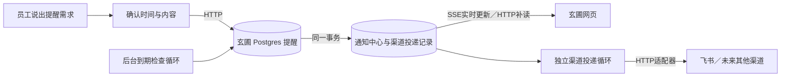

# 玄圃核心能力与持久提醒设计

用户已确认玄圃是企业核心并授权继续实现、设计与本地验收。外围办公、ERP、邮箱、财务等系统可替换。沿用该授权推进，不重复要求配置或批准技术实现选择。

## 目标与分期

全产品按可独立验收的领域推进：A 持久提醒与通知中心；B 企业身份与来源权威配置、双向同步；C 事项、审批、文档版本与签收；D 业务系统适配与财务等流程。领域都围绕玄圃身份、权限、事件、状态和审计，不能以供应商功能作为产品上限。

本次实现 A 完整闭环：普通员工自然语言提出提醒，系统展示准确时间/时区/重复规则/送达位置，确认后持久保存；可查看、修改、取消；后台到点产生站内通知；网页可断开、服务可重启，多实例不能重复生成。飞书是可选发送渠道，独立失败可重试；不伪造企业微信、邮箱适配已经完成。不执行任意模型生成的定时脚本，不替用户发报销或审批。

## 调度和传输决策

- 提醒记录与通知中心在现有 Postgres 控制面持久化。memory 后端仅测试，明确重启丢失。
- 后台循环每秒扫描最多100条到期记录；每条在短事务中锁定、检查当前版本与状态、插入唯一通知、更新下次时间或完成。事务中无模型/网络调用。数据库事务是事实来源，进程计时器仅唤醒，不存未来任务。
- 到期身份重新检查，已停用员工/租户不再产生通知；停用监听取消员工未完成提醒。崩溃未提交则下次再处理；已提交不会重复。通知唯一键为提醒ID与计划触发时间。
- 一次性逾期任务重启后补发一次并显示原定时间；每日/每周逾期只合并最近一次，下一次按用户时区计算，避免恢复后刷屏。首版支持 once/daily/weekly；其他规则说明不支持，不悄悄降级。
- 用户时区默认 Asia/Shanghai，浏览器自动提供有效 IANA 时区；API显式传时区。模型看到服务端当前时间与时区，不能自行决定“今天”。持久时间为UTC时间戳。重复规则按本地钟表时间，DST重复小时只触发一次，缺失小时跳过当天。
- 网页通过 HTTPS SSE 接收通知变化（开发为HTTP）；HTTP POST/PUT/DELETE处理操作。SSE携带游标、心跳、定期重新鉴权，断线重新拉取通知列表。没有双向高频通信需求，不引入WSS；WSS也不是后台定时器。连接断开不影响调度。
- 已读与外部送达分别记账，飞书失败不会回滚站内通知。外部发送使用带租约与重试时间的outbox、稳定幂等键，最多5次，明确失败/跳过；无法保证外部接口无限期 exactly-once，记录重试边界。

## 成熟组件取舍

使用已有Postgres事务/行锁、asyncio生命周期、FastAPI流式HTTP、zoneinfo时区与httpx发送。Celery/Redis、Temporal可用于后续长工作流，但本次只需数据库内的短事务状态转换，引入另一套任务持久化会增加双写一致性和本地部署要求；APScheduler持久job不能代替业务通知与状态的同事务提交。因此不另造通用调度框架，只实现提醒领域的到期状态转换。参考 PostgreSQL SELECT锁文档与WHATWG SSE协议。

## 数据与接口

所有记录必须带 tenant_id/user_id。后台可扫描全局到期ID，拿到记录后操作仍限定tenant/user/id/version。普通API凭据无user_id不能建立个人提醒；允许已有严格act_as机制。

Reminder：reminder_id、tenant_id、user_id、title、due_at、timezone、repeat(once/daily/weekly)、channels(inbox必选,feishu可选)、status(active/completed/cancelled)、version、request_id、created_at、updated_at。title<=500字；每人最多100条活动提醒；时间必须未来且不超过5年；无效时区、非有限时间、未知字段、未知渠道拒绝。
Notification：notification_id递增游标、tenant/user、reminder_id、title、due_at、created_at、read_at；保留原计划时间，用户可看到延迟。相同(reminder_id,due_at)最多一条。
Delivery：notification_id/channel唯一，status、attempts、next_attempt_at、lease_until、claim_token、last_error_code、first_attempt_at；失败不记录供应商正文或密钥。

- POST /v1/reminders：创建；request_id由客户端生成，重复同内容返回同记录，不同内容409。
- GET /v1/reminders：本人列表，含已完成/取消，最多100条，可按状态过滤。
- PUT /v1/reminders/{id}：编辑活动提醒，带version，过期版本409；编辑正文/时间/重复/渠道，幂等request_id仅创建使用。
- DELETE /v1/reminders/{id}?version=N：取消，版本冲突409；已完成不能冒充取消，重复取消可返回原取消记录。
- GET /v1/notifications：本人通知，after_id>=0,limit<=100；返回items与游标。
- POST /v1/notifications/{id}/read：幂等标读，本人范围。
- GET /v1/notifications/events：SSE，after_id/Last-Event-ID，周期重新认证与停止；持久查询，不依赖进程内队列。

自然语言路由增加平台内置reminder能力，未安装任何业务包也可用。模型输出仅是待确认草稿，不能直接产生后台任务、不能指定用户或租户。API route在原session/message响应上加可选reminder_draft，普通业务不受影响。缺时间等则澄清。日期/时区/重复规则由服务端严格验证；过期时间不自动猜明天。创建成功的说法只能在POST落库成功后显示。

## 体验和安全

展现策略已按用户后续纠正更新，见[对话能力按需显示](2026-10-05-conversation-capabilities-design.md)：侧栏常驻提醒和手动新建已取消，管理操作仅在对话请求后展示，通知独立入口。以下旧布局描述以该新设计为准。

对话里用卡片展示提醒内容、绝对日期时间、时区、重复方式、实际送达位置。确认按钮防双击，失败保留草稿且复用request_id；取消草稿不写库。侧栏显示提醒与通知，修改有明确表单。无需员工输入密钥或选择业务。仅管理员已配置连接可用于外部渠道；无可用渠道也有站内能力。页面关闭时站内通知仍保存，但不会承诺浏览器关闭后系统弹窗。

所有DOM正文用textContent；SSE不在URL放token；身份切换清空列表、草稿、游标并取消流与在途请求；当前会话历史不混入其他用户。控制面审核提醒写入、修改、取消、到期产生；保持租户/用户筛选。敏感内容不进入错误日志。

## 验收

同一套memory/Postgres契约：幂等创建、修改CAS、取消竞争、双实例到期只一条、重启恢复、重复时区/DST、过期合并、租户/用户隔离。服务：停用后不执行、异常恢复、退出取消循环、发送重试/租约/失败边界。API：个人身份/CSRF/跨人404/非有限时间/大输入/SSE重鉴权。浏览器：自然语言→预览→确认→列表→修改/取消、真实到期消息、刷新恢复、账号隔离、窄屏。真实模型解析中文“明早8点”与缺时间澄清；外部发送用模拟接口验收，不向真实员工发测试消息。最终全测、lint、mypy、构建、主线本地部署及Postgres真实重启验收。

参考：https://www.postgresql.org/docs/current/sql-select.html；https://html.spec.whatwg.org/multipage/server-sent-events.html；https://open.feishu.cn/document/server-docs/im-v1/message/create

## 一致性审查补充（必须实现）

1. Postgres统一锁顺序：租户行→用户行→提醒行。同一用户创建、通知生成都串行锁用户；通知ID在持有用户锁后分配并与事务提交，确保该用户的游标按提交顺序可见，跨用户ID空洞不影响查询。到期事务与停用更新使用冲突行锁，测试逆序候选处理不会漏通知。
2. 员工停用事务同时取消未完成提醒、将未发送外部任务标为skipped。InMemoryIdentityStore在同一无让出状态变更中作同等处理；不能只依赖进程内监听。重新启用不恢复旧提醒。租户停用不产生/发送，恢复后按逾期策略补发。
3. 通知、所有选中渠道outbox、提醒下次执行时间同事务提交。网络发送前再次检查身份和渠道配置；租约30秒，单次网络最长10秒，每次领取生成新的claim_token，回写须匹配该token及当前状态，隔离过期工作者；供应商幂等键保持稳定。已发出的网络请求可能在停用后完成，不承诺撤回。
4. 创建唯一键(tenant,user,request_id)，独立保存原始规范化创建内容指纹。先命中幂等记录，再检查未来时间与活动数量；编辑不改变原创建指纹。每用户100条上限在用户锁内检查并插入，99条并发创建仅一条成功。
5. 站内提交为exactly-once；外部渠道是有限重试，可能重复或最终失败，依赖供应商幂等窗口降低重复风险，超出窗口或投递状态不明时显示明确状态，不声称无限期无重复。

6. 提醒创建/修改/取消及触发审计与领域状态原子提交；审计存储失败不能留已生效但无审计的操作。租户暂停不占用全局100条候选窗口。外部投递首次尝试起最多一小时，状态未知超窗明确失败，不进行无限期重发；明确尚未外发的首次暂停归还尝试计数与起点。

到期检查和外部投递使用两个独立且可取消的后台循环；外部请求变慢不会阻塞下一轮站内到期检查。关闭平台时同时取消并等待两个循环和所有在途发送，之后再关闭连接池。每轮数据库扫描仍受当前数据库响应时间影响，不承诺硬实时。
