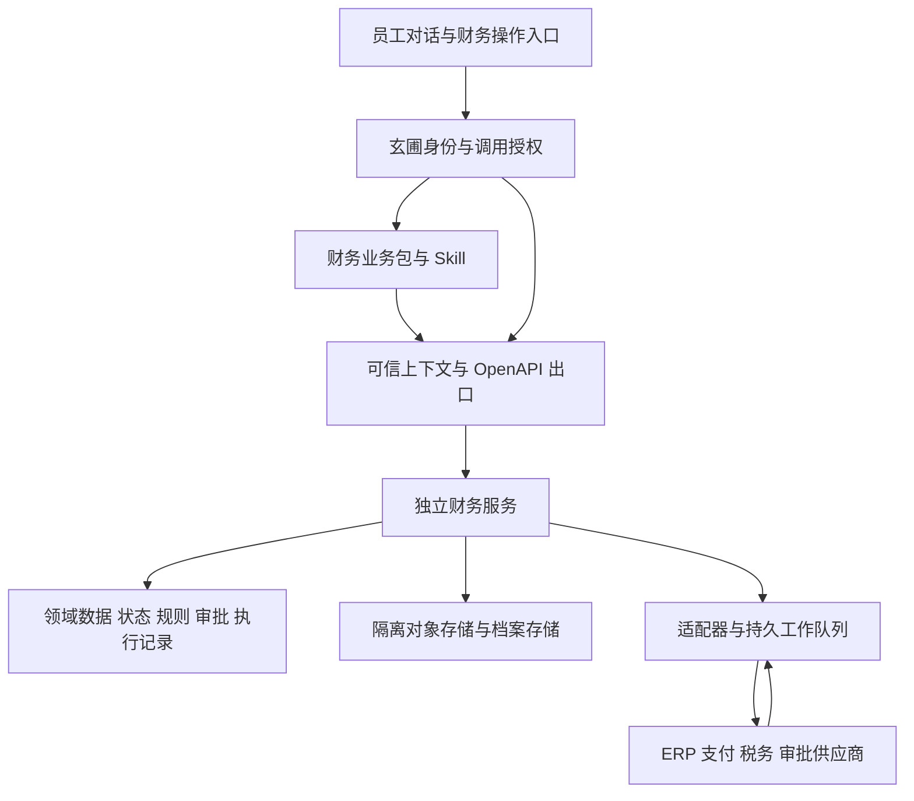

# 玄圃财务业务能力包设计

状态：范围已确认，书面设计待用户审阅；本目录契约不是已部署服务。日期：2026-10-21。

用户确认首期覆盖“发票 → 报销／应付 → 审批 → 付款结果 → 入账回执 → 归档”，接入现有记账、支付和税务系统。
用户进一步确认采用 HITL（关键节点由人确认或审批），财务存储完全独立；这两项为后续实现的明确约束。
本设计定义完整闭环；按 F0—F3 分开实现和验收，不把完整财务体系压进一个实施任务。

## 1 交付物与现有基线

- [用户原始规范](finance-v1/source-requirements-v1.md)：保留 V1.0 原文，修订依据见第 3 节。
- [F0 发票基座详细设计](2026-10-21-finance-f0-design.md)：首个可独立实现和验收的子项目。
- [领域与流程契约](finance-v1/domain-contract.md)：对象、状态、金额约束、异常处置和数据归属。
- [业务包清单草案](finance-v1/pack/xuanpu.yaml)：一个入口、六个子 Skill、声明式 HTTP 工具。
- [业务 OpenAPI 草案](finance-v1/pack/apis/finance.yaml)与[主数据 OpenAPI 草案](finance-v1/pack/apis/catalog.yaml)：同一独立服务的分组契约，逐操作标识交付阶段；所有服务能力均需实现。
- [验收矩阵](finance-v1/acceptance-matrix.md)：业务、故障、授权、模型和正式通道分别验收。
- [独立审阅与校验记录](finance-v1/review-record.md)：发现的问题、修正、实测结果及尚未运行的财务验收项。

代码基线为本地 xuanpu `be36853`。R1 已有工作任务、输入版本、执行空间、成果和本人确认；参见
[R1 验收](../../guides/releases/2026-10-21-r1-acceptance.md)。该记录不代表 R1 已部署生产。
现有 `runtime/http_api.py` 能按 OpenAPI 调用固定目标，注入租户服务凭据；
`runtime/approval.py` 控制工具副作用，`runtime/operation_receipts.py` 记录批准核销，均不等于财务业务审批或付款成功。
当前未发现财务领域服务、可信员工上下文透传或正式税务／支付适配器。

## 2 定位与架构

玄圃拥有企业业务规则、授权决定、流程、财务业务单据与审计；外部 ERP 拥有选定账套的正式账簿、
支付渠道拥有实际资金交易结果，税务渠道提供税务动作的权威回执。所有映射带来源和外部 ID，替换适配器不改业务主键。
普通员工通过对话交办；财务人员保留直接查询和处理入口。两种入口调用同一服务，模型停用不影响既有单据处理。

新增运行组件拟为 `packages/xuanpu-finance`，独立 FastAPI 进程与版本；不被 xuanpu-server 导入。
财务服务不依赖 taifeng，不把财务模型放入 xuanpu-spec；平台只增加通用可信调用上下文，遵守 ADR 0002／0008。
服务使用 PostgreSQL 事务、约束和有界工作队列，S3 兼容对象存储，受控 XML 解析与标准版本映射。
使用成熟的 FastAPI、Pydantic、asyncpg、cryptography、defusedxml 和对象锁能力；
自建部分仅限现有组件不提供的财务领域状态、规则、金额分配与供应商回执映射，不自建 XML 解析器、密码算法或消息中间件。

### 2.1 独立存储与模块启停

财务业务使用独立 PostgreSQL 实例、数据库、账号与迁移，不与平台共用业务表或仅以 schema 分区。
财务原件和档案使用独立对象存储资源、桶和访问凭据，独立设置加密、保留、对象锁及备份；不共用平台对象桶或平台存储凭据。
可部署在同一物理宿主机，但存储服务、数据卷和恢复生命周期独立；这种部署不构成物理故障域隔离，需更高可用性时部署到不同宿主机。
平台进程不持有财务数据库／对象存储凭据，财务服务不持有平台数据库／对象存储凭据；跨系统交互只走受权 API。
员工、任务及外部单号只保存稳定引用和必要证据快照，不设跨数据库外键、触发器、共享事务或直接 SQL 查询。
用户从平台提交的原件，经文件桥传入后先在财务存储形成可验证副本；只有副本与来源事务已提交才标记成功收件。
财务已接收的原件、审批、回执和档案不能因平台原文件删除、会话结束或能力包停用而丢失。
平台可以显示财务单据引用、脱敏进度和通知，财务记录及原件的权威正本留在财务存储；输入、文件桥传输与平台既有材料的访问审计仍由各自系统保存。

财务模块可不安装；关闭财务不影响玄圃的普通办公功能。身份和权限通过平台 API 接入，存储独立不取消这种明确的运行依赖。
身份服务不可用时不发起需在线复核的新财务副作用；对已发送操作允许独立 worker 验证回调、只读查单并保存真实回执，不能借故重付。
启停状态为 enabled／draining／read_only／disabled：enabled 接收新业务；draining 停止新业务并核清在途操作；
read_only 保留有权历史查询；disabled 移除用户可调用入口。存在未核清外部操作时不得关闭必要的回调和核对进程，进入 disabled 前必须完成在途交接。
停用与卸载不删除财务数据；恢复启用前核对存储、迁移、授权、通道及在途账目。财务库与对象独立备份、恢复和导出，平台升级无需迁移财务库。

财务任务 ID、玄圃工作任务 ID、会话 ID 与外部请求 ID 各自保存映射。财务队列独立持久，不能把 R1 的进程任务当作
可自动恢复的支付队列。R1 中断不会删除财务操作；重新进入只读操作记录，不重放外部写入。

## 3 对原始规范的修订

| 原要求 | 本设计的明确处理 | 性质 |
| --- | --- | --- |
| L1 XML 是唯一法定原件，PDF／OFD 仅展示 | 保留真实接收的原始文件；数电票结构化链路优先 XML。F0 无 XML 可收件并进入待补原件，不得进入 XML 标准处理成功态；按票种与来源声明接受的原件格式 | 内部处理策略与法规表述分开 |
| 只有已入账才需要红字确认 | 税务用途确认或税务入账确认任一成立时适用对方确认分支；ERP 入账单独记录 | 依据 S2 |
| RED_ISSUED 一律禁止确认 | 分开红冲锁定、累计红冲金额、明细与剩余可用额度；全额与部分红冲分别处理，不覆盖蓝票原值 | 依据 S3，并执行当前通道规则 |
| 72 小时到期自动作废流程 | 保存权威发起时间、到期时间和时区，提示后回查渠道；本地到期只标记待核实，不自行解锁 | S2 与工程保守处理 |
| 票面一个税率 | 明细级税率／税额／免税标识；票头税率仅作展示摘要 | 支持混合税率 |
| 金额一致、主体一致、固定时间顺序 | 按垫付、预付、分期、委托收款等场景配置规则，附证据和例外授权；0.01 元和 30 天仅为企业策略初值 | 不当作普遍法定条件 |
| 键值字段代表标准符合 | 关键类型化字段用于约束和统计，标准数据元另带标准 ID、版本、路径、原始值；未经官方元素清单核对不使用标准符合标记 | 依据 S4 |
| 单据关联只保存外部单号 | 支持玄圃原生业务单据与外部引用；外部对象不可伪造，手工提供材料标明来源和核实状态 | 与企业核心定位一致 |
| 哈希链可代表防篡改归档 | 哈希仅证明比对一致；另记录签名／验真、四性检测、对象锁模式和保留期限、备份及恢复证据 | 分层验收 |
| 重复票在作废后可以再次建主记录 | 同一租户、公司、票种身份键始终唯一；再次接收只增来源，不解除身份唯一约束 | 工程不变量 |

## 4 能力与 Skill 分工

| Skill | 输入与输出 | API 范围 | 服务端约束 |
| --- | --- | --- | --- |
| finance-assistant | 业务目标 → 路由、进度和证据摘要 | 公司、集成状态、操作查询 | 不接收模型自报身份，不替其他角色批准 |
| invoice-intake | 受控文件版本 → 归集、查验及异常 | 导入、发票、查验、证据 | 原件、票种、唯一性与解析版本 |
| expense-reimbursement | 员工费用 → 报销版本、金额分配 | 报销、分配、提交预检与执行 | 本人权限、可用额度、制度、版本 |
| accounts-payable | 合同验收和付款需求 → 应付、付款计划 | 应付、分配、付款预检与执行 | 供应商主数据、收款账户版本、审批分工 |
| finance-review | 待审和异常 → 有依据的审核决定 | 异常查询、审核预检与执行 | 有权审核人身份、禁止自审、材料固定 |
| posting-reconciliation | 已批准业务 → 支付／入账回执核对 | 预检、执行、操作查询 | 付款与记账权限分开，结果未知先核对 |
| archive-audit | 票据或业务 → 档案、证据包及缺口 | 归档预检与执行、档案、证据 | 四性检测、清册、保留与追加证据 |

清单只开放明确工具，写操作使用平台 `standard` 调用确认。平台确认与业务审批独立；
服务端无论调用来自 Skill、脚本或操作页面，都执行相同权限、状态、版本、额度和证据检查。
模型只建议费用分类、匹配和异常说明；金额由 Decimal／SQL numeric 计算，状态只接受领域命令。
企业制度、票面备注、XML 和回调文本均为不可信业务内容，不能改变工具权限、收款账户或审批链。

## 5 身份传递和授权

现有租户服务密钥只能证明服务身份，不能证明哪名员工授权。F0 对话接线的前置条件是新增通用可信调用上下文：

1. xuanpu 由已认证会话／操作页面构造上下文，不读取模型提供的租户、员工、角色或审批者。
2. 在 HTTP 出口发送前签名，使用独立的非对称签名密钥，公钥按 key ID 分发到财务服务，支持轮换。
3. 载荷固定 `iss/aud/sub/tenant_id/session_id/call_id/jti/iat/exp/request_sha256`；有效期 60 秒，时钟容差 5 秒。
   请求摘要覆盖大写方法、规范路径、有序查询参数、规范 JSON、Idempotency-Key 和 Content-Type；
   有业务语义的新增头必须先纳入规范化签名清单，未知语义头拒绝。签名不覆盖自身、Authorization 或日志敏感值。
4. 出口覆盖 `X-Xuanpu-Context`，从模型可填写的参数／头中保留该名称；财务服务拒绝缺失、篡改、过期、错 audience 或请求摘要不符。
5. 业务所属公司是模型可以选择的目标，不是授权凭证。财务服务查询可信授权目录，核实当前员工、公司、岗位、单据数据范围；
   对不存在或不在范围的对象统一 404，账户停用为 403。授权目录不可用则拒绝新的用户业务命令与需要授权的外部副作用。
6. 非对话调用也经玄圃认证网关签发同一种上下文；外部 ERP 和支付回调使用独立供应商认证通道，不能伪装员工。

JWT 签发／验签采用成熟库并锁定允许算法，禁止 `none` 或由令牌选择任意算法。服务凭据与签名密钥不交给模型或沙盒。
目录采用平台签名授权快照同步加撤权查询；新的用户业务命令受理前和外部副作用发送前必须在线复核，拒绝已停用员工或撤回的审批。
既有已发送操作的验签回执与只读查单结果，由独立财务服务身份校验并落库，不要求员工授权目录在线；
该例外不能改变收款方、扩大金额、创建新付款或触发其它新副作用。
后台 worker 使用独立服务身份和持久 `execution_grant_id`，不续用过期的员工令牌；授权只允许执行已批准且摘要一致的计划。
重放表以 `(issuer,jti)` 唯一，保存原 subject、request_sha256 与 Idempotency-Key，留存到过期加 5 秒；
再次出现只允许全部一致的幂等重放，任何不一致拒绝，不能把摘要放进唯一键后漏检异内容重放。

## 6 预检、批准、执行与回执

### 6.1 HITL 与后台续办

HITL 设置在员工提交确认、主管／财务业务审批、按制度要求的付款／税务决定以及异常处置节点。
正常识别、匹配和状态查询按受权范围自动进行；关键决定交给实际有权人员，之后由持久后台任务继续推进。
每个待办明确“谁决定、决定什么、目标版本、金额与影响、证据、到期及可选动作”，支持批准、拒绝或补材料；负责人由制度配置的后台分派确定。
等待与决定持久化在财务数据库的 ApprovalWorkflow／ApprovalDecision／ExceptionCase 中，不依赖某次模型调用、聊天窗口或内存中的挂起状态。
页面关闭、模型停用和会话过期不撤销合法待办；恢复后从财务服务查询状态，决定经身份、版本和幂等校验后续办。
超时按制度提醒或升级，不能自动代表批准；有权人修改金额、收款账户、材料或授权范围后重新校验并取得必要决定。
业务级 HITL 与平台工具调用确认各自保留。当前草案仍使用 standard 的保守调用确认；减少重复接口确认需先实现并验收
绑定人员、资源、动作、金额、有效期且可撤销的通用执行授权，不能简单改为 relaxed 或靠 Skill 文本绕过平台闸门。

### 6.2 计划、授权和执行记录

`action-previews` 持久化不可变计划，输出影响、阻断、所需批准和证据缺口；它不占用发票余额、不付款、不入账。
提交／审核决定的执行预览有效期 15 分钟，付款／记账／税务／归档的待批准行动计划默认有效 24 小时，上限 72 小时，企业可缩短。
计划固定目标版本、分配、金额、币种、收款账户版本、规则版本、适配器版本及授权范围；长有效期不能省略执行时复核。

动作集合为 `submit_claim/submit_payable/approve/reject/withdraw/execute_payment/submit_posting/reverse_posting/confirm_usage/confirm_tax_entry/confirm_red_letter/archive`。
approve／reject 是有权人对指定业务版本的决定；平台“允许调用”不能产生该决定。
approve 的 plan 指定工作流实例及步骤，服务验证实际审批者与职责分离；reject 必须含原因。
业务单据提交时创建单据审批工作流；付款／记账／税务／归档预检在需要专用批准时创建与 action_plan.digest 绑定的工作流，
进入同一个 review-queue。审核人通过 getActionPlan 查看原计划，以 target_type=action_plan、target_id=原计划 ID
预检并执行 approve／reject，得到对原计划摘要的决定和专用 ExecutionGrant。批准动作本身不再套娃要求另一份计划批准，
但必须核实实际审核资格、职责分离和明确业务决定。不得批准 action=approve／reject 的计划，避免递归授权。
计划到期、被驳回、目标版本／规则／账户变化或授权撤回时，原批准与 grant 不再可执行；新预检生成新计划并重新审批，不能迁移旧决定。
初次提交时在事务中核实并保留 InvoiceAllocation，业务审核后生成限定用途、金额和对象版本的执行授权。
付款、入账、税务、档案动作用各自所需审批，不能从报销审批隐式取得税务确认权。

执行提交同事务校验计划有效期、CAS 版本、审批、规则和金额，写 `Operation + StateEvent + Outbox` 后返回 202。
`Idempotency-Key` 按租户、主体、公司、operationId 隔离；同键异内容 409，同内容重放返回原操作，不再次执行。
预检可以重新生成，但不会迁移旧批准；同业务动作即使换幂等键也受计划唯一执行约束及领域唯一约束保护。

worker 在外部发送前持久化 `dispatching` 和外部幂等键，发送后区分渠道受理与业务完成。
确认成功后再更新业务状态。重试只用于已知未发送或供应商保证幂等的瞬时失败；业务拒绝进入异常池。
发送后超时、连接中断或取消进入 `outcome_unknown`，保留金额占用；按原外部请求号查询，不生成新付款请求。
取消仅表示请求停止尚未发送的工作，不能宣称撤销已发送的付款。外部已完成操作通过新的冲回／退款业务处理。
通知在领域事务提交后通过 outbox 派送，不以通知成功作为业务成功依据。

## 7 接口和文件约束

契约为 OpenAPI 3.0.3，金额用两位小数字符串，CNY 为首期币种；汇率和跨币种核算不在首期执行范围。
身份不出现在请求 body 中。公司 ID 是受权限校验的业务目标。实体所有读写含 tenant 与 legal_entity 隔离。
查询采用不透明游标与 limit 1—100；总数按权限及过滤条件独立计算，不从当前页推算；畸形响应不得当零。
费用分类、部门／项目、采购依据及已核实收款账户从 catalog 工具查询；分配对象和计划有独立读取接口，重新进入会话不依赖模型记忆。
所有写接口要求幂等键，单据更新要求 `expected_version`；错误用稳定 code、trace_id、可读 message 及 retryable。
不存在通道或无有效授权返回 `integration_unavailable`，不返回合成成功回执。

HTTP 连接器当前只支持 JSON。导入提交玄圃文件 ID、revision 和 SHA-256，由可信文件桥按同一员工权限读取；
不接受任意 URL、对象键或宿主路径。原件下载通过受权限校验的网关，给 Skill 的证据只包含引用和脱敏摘要。
F0 单批最多 100 文件、每文件 20 MiB，总量 100 MiB，独立财务导入限制与上游限制取更小者；
不会因此扩大现有 R1 工作任务附件限额。XML 禁止 DTD／外部实体、网络 schema、深度大于 64 与超过 100000 元素；
超限入异常，原文件隔离保留。真实凭证 schema 包由受控标准目录本地提供，不能从 XML 声明任意下载。

## 8 数据归属与冲突

| 对象 | 权威来源和同步方向 | 冲突处理 |
| --- | --- | --- |
| 员工、岗位、公司授权 | 玄圃 → 财务服务 | 写入在线复核，停用或撤权阻断新动作 |
| 报销、应付、业务审批与分配 | 玄圃财务领域 → 外部引用／同步 | 外部变更作为差异事件，不能覆盖已批准版本 |
| 合同／订单／验收 | 每公司配置来源，原生或外部 → 匹配快照 | source + external_id + version 固定；版本改变使匹配失效 |
| 正式凭证与期间 | 选定 ERP → 回执，玄圃 → 提交 | 凭证唯一标识含账套／期间／凭证 ID；有差异暂停推进 |
| 税务票据状态与确认 | 税务通道 → 财务事件，授权命令 → 通道 | 不由本地推断外部成功；旧事件不回退新状态 |
| 支付结果与电子回单 | 支付通道 → 财务记录，授权付款 → 通道 | 订单与交易分别映射，未知时查询和对账 |
| 归档内容与状态 | 财务服务生成 → 档案存储返回锁定证据 | 归档包不可覆盖；新事实新增补充包和关联事件 |

供应商更换按业务截止点迁移稳定映射、在途操作、原始回执和旧查询通道；在途未知结果未核清前不切新通道重付。

## 9 异常与运营

异常类型含原件缺失、解析失败、验真失败、疑似重复、主体差异、超额分配、收款账户变化、红冲影响、
期间关闭、外部未知、回调冲突、档案检测失败。每项保存阻断级别、规则版本、证据、负责人、截止时间与处置事件。
查验通道不可用是 `unavailable`，不能标记票假；字段解析成功不是查验成功；人工复核不能伪造税务成功。
软规则的接受必须有授权角色、原因、适用版本和证据；原件完整性、越权、重复付款等硬约束不可豁免。
每公司配置财务异常负责人；缺少负责人会阻断该公司启用写流程，避免任务无人承接。

审计分开记录业务事件与访问／配置日志；银行账号和身份数据脱敏，原始敏感数据使用密钥管理加密。
运行日志不保存原 XML、完整账户或令牌。会计档案保留期按适用类别和规则版本配置，不能套用普通日志“6 个月”。
对象锁、密钥轮换、备份恢复和法律保留须单独验收；未证明有效时，档案状态不能为已归档。
监测队列年龄、待审批时长、查验失败率、未知结果数、红冲到期、回调拒绝与档案检测失败；追踪使用内部 ID 和 trace_id。

## 10 分阶段交付与依赖

| 阶段 | 独立交付 | 前置与验收边界 |
| --- | --- | --- |
| F0 发票基座 | 可信身份／文件桥、原件收件、解析适配、唯一主记录、状态审计、查询与 invoice-intake | 按 F0 设计验收；只开放 F0 工具，不把未实现操作注册到生产 |
| F1 报销与业务审核 | 单据版本、分摊、金额占用、制度规则、原生审核、异常处置与手动兜底 | F0 稳定；同票并发与提交版本冲突通过真实数据库测试 |
| F2 应付付款与 ERP | 订单验收匹配、应付、支付计划、执行授权、付款及入账回执、对账 | 供应商沙箱、接口权限、幂等／查单能力逐项核实；无查单保障的通道禁用自动重试 |
| F3 税务与档案 | 查验／用途／税务入账确认、红冲、进项转出跟踪、不可变档案与审计 | 正式通道与版本化标准样本、档案四性和对象锁证据；税务申报本身不在本期 |

F0 有解析测试适配器与人工证据采集，不声称官方验真。F2 的供应商型连接独立开工作包，每个工作包只交付一个通道的
提交、查单、回调与对账；不预先假设具体 ERP、银行或税务供应商。完整实施计划在书面设计审阅后按上述子项目拆分。
F1／F2 可独立验收草稿、审核和隔离测试通道；依赖发票有效性的正式入账／用途确认等动作必须已有真实且有效期内的查验结果。
F3 查验通道未就绪时，对应正式动作保持阻断，不能以阶段完成或人工改标绕过；预付款等尚未取得发票的独立业务按其专用证据和审批规则执行，
不要求核验一张尚不存在的发票，也不得伪造发票以通过检查。
进程重启后，领域队列恢复仅处理已证明无外部副作用的工作；dispatching 和未知操作先核对，绝不重放付款／税务写入。

## 11 发布与验收

验收矩阵见独立文件。源码门禁、真实数据库、Skill／真实模型、真实供应商沙箱、候选镜像、部署、正式财务样本和标准验证分别留证。
模拟适配器不得计入正式接口验收；合成 XML 不作为标准符合证据；模型说“完成”不能改变业务记录。
正式接入前收集公司税号／账套、供应商接口文档与授权、原始票据样本及标准包、审批分工、报销制度、
供应商账户主数据来源、档案保管分类与存储对象锁配置。缺项阻断对应功能启用，不阻断不依赖它的开发和测试。
首期不自建总账、工资、税务申报、外币结算和自动银行开户；报表只汇总已确认范围，并同时列出未核实与在途金额。

## 12 来源与规范适用

以下资料于 2026-10-21 检索。官方内容支持明确列出的事实；具体标准 XML 元素、验签和归档格式须另用官方文件包与真实样本验证。

- S1：[税务总局数电发票格式说明](https://www.chinatax.gov.cn/chinatax/n810356/n3010387/c5236173/content.html)：XML 与 PDF／OFD 并存。
- S2：[2024 年第 11 号公告](https://zhejiang.chinatax.gov.cn/art/2024/11/13/art_24085_629347.html)与[上海税务答疑](https://shanghai.chinatax.gov.cn/zcfw/rdwd/202508/t477256.html)：用途或入账确认、红字确认单 72 小时及特定票种分支。
- S3：[辽宁税务数电票答疑](https://liaoning.chinatax.gov.cn/art/2024/6/19/art_782_129656.html)：特定已入账未确认用途场景下，部分红冲后未冲部分的抵扣处理；不得外推所有票种。
- S4：[财政部电子凭证会计数据标准应用指南](https://kjs.mof.gov.cn/zt/kuaijixinxihuajianshe/dzpzkjsjbzshsd/czznhjswd/202505/t20250519_3964019.htm)：标准应用依据，实施时绑定官方元素清单与实例版本。
- S5：[财政部电子凭证会计数据标准应用验证系统](https://kjs.mof.gov.cn/zt/kuaijixinxihuajianshe/dzpzkjsjbzshsd/gjb/202602/t20260204_3983327.htm)：可用于单独留存标准验证证据，不以内部 JSON 校验替代。
