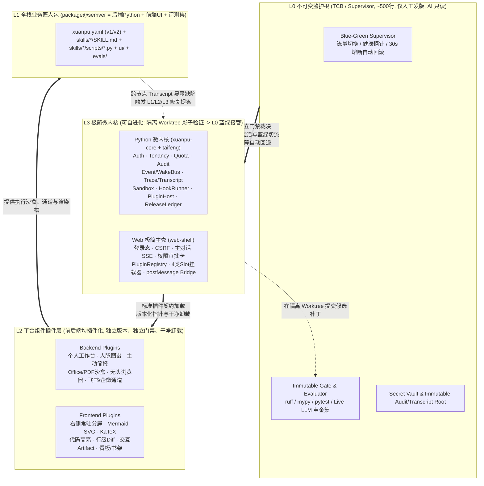
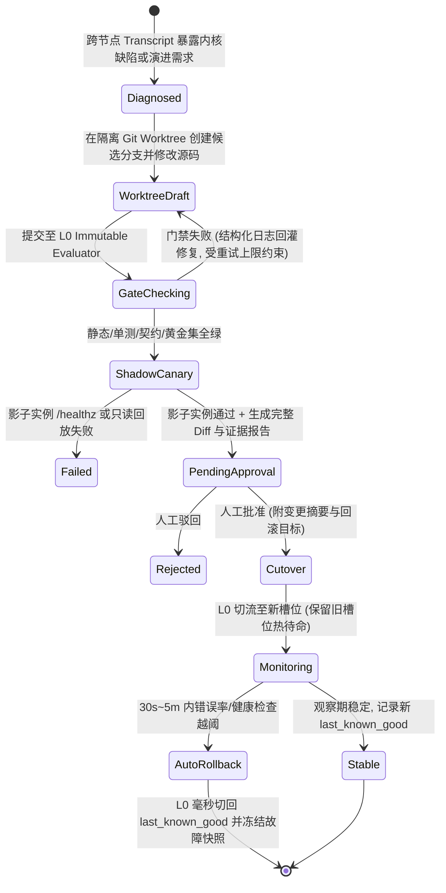
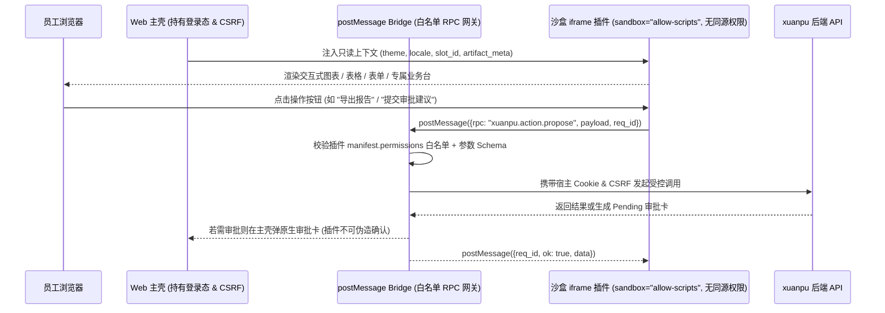

# 玄圃（xuanpu）全栈自进化微内核与插件化架构设计

- 版本：v1.0（Draft / 待拍板，2026-11-27）
- 关联决策：[ADR 0027：全栈自进化微内核（L0–L3）与前后端统一插件架构](../../decisions/0027-self-evolving-microkernel-and-plugin-architecture.md)
- 继承基线：[ADR 0004](../../decisions/0004-planes-and-effect-gates.md) · [ADR 0017](../../decisions/0017-butler-artisan-orchestration.md) · [ADR 0024](../../decisions/0024-event-driven-wakeup-and-task-board.md) · [ADR 0025](../../decisions/0025-artisan-forge-and-versioned-releases.md) · [ADR 0026](../../decisions/0026-local-transcript-and-cross-node-diagnosis.md)

---

## 1. 架构目标与核心原则

本架构同时回答两个根本命题：
1. **能力上限达标**：在日常办公、深度文档/数据分析、富媒体交互预览、长程多步编排与实时过程透明性上，正面达到 **Claude App（Desktop / Cowork / Code）** 与 **Antigravity App** 的体验水准；
2. **全层级安全自进化**：不止业务匠人，而是 **前端组件、后端模块、全栈业务包、乃至平台内核自身** 均具备可验证、可灰度、可一键原子回退的自进化迭代能力，且发挥纯服务端多租户形态“一处进化、全组织生效、7×24 在线”的代差优势。

### 五条不可违背的架构铁律

| 铁律 | 工程含义 | 反面后果（违反即禁止） |
| :--- | :--- | :--- |
| **1. 裁判与选手物理分离（Immutable L0 TCB）** | 负责门禁裁决、蓝绿切流、健康熔断回滚、凭证保管与只读审计的 **L0 监护根（~500 行）** 永不自改，AI 永远没有 L0 的写权限。 | 允许 AI 修改评测脚本或监护器，等于选手可以改考卷和哨子，系统失去底线。 |
| **2. 永不原地热改自身（No In-Place Self-Mutation）** | L1/L2/L3 任何层级的进化，一律在**隔离沙盒 / 隔离 Git Worktree** 构造不可变新版本 → 全套门禁验证 → 原子切换发布指针。 | 在线覆写正在运行的源码或静态目录，一次语法错即可导致全服瘫痪且无法自救。 |
| **3. 微内核极简化，一切业务皆插件** | 内核只保最小底座原语，业务域、前端富渲染器、重型执行器（Office/浏览器/IM通道）全部按统一契约插件化，支持**干净卸载（Clean Unmounting）**。 | 把全部功能堆进 `platform.py` 与 `entry.js`，耦合膨胀到 AI 与人都改不动。 |
| **4. 前后端安全边界零穿墙** | 后端插件按信任级隔离运行（核心受审进程内 / 高危独立沙盒）；前端第三方或 AI 生成插件一律运行在无同源权限的隔离 iframe，**永远摸不到 Cookie、CSRF 与主页 DOM**，仅经白名单 `postMessage` Bridge 通信。 | 前端插件直接注入主站 JS，一次 Prompt 注入即可 XSS 窃取管理员凭据。 |
| **5. 数据与协议只扩不删（Expand-and-Contract）** | 涉及数据库表、事件帧、API 契约与清单规范的演进，新版本必须向后兼容旧版本数据，确保任意时刻切回上一节点零崩溃。 | 新版删列/改字段导致蓝绿回滚失败，自进化变成“单程票”。 |

---

## 2. 全局顶层拓扑：L0–L3 四层自举微内核



### 四层职责与进化节奏一览

| 层级 | 承载对象 | 构造方式 | 生效机制 | 回退方式 | 典型迭代周期 |
| :--- | :--- | :--- | :--- | :--- | :--- |
| **L0 监护根** | 进程/容器切换器、门禁裁判、黄金评测集、凭证与审计根 | 人工代码仓评审 | 人工运维发布 | 人工回滚 | 季度级（极少变动） |
| **L3 极简内核** | `xuanpu` 微内核、`taifeng` 稳定内核、`web-shell` 主壳 | 隔离 Git Worktree + 影子进程 | L0 全套门禁 + 人工审批 + 蓝绿切流 | L0 自动熔断（30s）或一键切回旧节点 | 周/月级 |
| **L2 平台组件插件** | 后端领域插件、重型沙盒执行器、前端富渲染器与工作台视图插件 | 隔离工作区 + 双向契约回归测试 | 版本化插件清单 + 灰度开关 + 干净卸载切换 | 原子切回上一 `plugin@semver` 节点 | 天/周级 |
| **L1 全栈匠人包** | 租户业务流程（后端 Python 脚本 + 专属前端 `ui/` 插件 + `evals/`） | 管家 `ArtisanForge` 沙盒自造 | L1/L2/L3 自动门禁 + 管家审核 + R4 发布 | 追加回退节点，**前后端原子同步回退** | 分钟/小时级 |

---

## 3. L0 不可变监护根（Supervisor & Immutable Evaluator）

L0 是整个系统“能自进化但绝不失控”的物理锚点，**必须以独立操作系统用户/只读卷运行于 `xuanpu-server` 之外**。

### 3.1 目录与权限隔离

```text
/opt/xuanpu-l0/                   # root / supervisor-user 所有，xuanpu-server 与沙盒严格只读或不可见
├── supervisor/
│   ├── controller.py             # 蓝绿实例拉起、/healthz 与业务探针巡检、流量切换、自动熔断回滚
│   ├── release_state.json        # 当前 active_slot (blue|green)、last_known_good、切换审计链
│   └── policy.yaml               # 不可自改的硬红线（必需门禁项、回滚窗口、禁止修改路径列表）
├── evaluator/
│   ├── run_gates.py              # L0 统一裁判入口：ruff + mypy + pytest + 契约兼容 + 影子冒烟
│   └── golden_evals/             # Live-LLM 端到端黄金评测集（20–30 个真场景，选手不可篡改）
└── vault/                        # 根密钥与蓝绿切换审批凭证
```

### 3.2 L3 内核自进化与蓝绿切流状态机



- **数据库迁移铁律**：L0 门禁在 `GateChecking` 阶段自动运行静态 Migration Linter，凡包含 `DROP TABLE`、`DROP COLUMN`、`ALTER COLUMN ... TYPE`（破坏性缩容）或非空无默认值新增列的迁移，直接阻断自动蓝绿发布，强制走两阶段人工变更。
- **与现有代码衔接**：直接演进现有 [l3_blue_green_release.py](file:///Volumes/Codes/lumorax/lumorax-platform/xuanpu/scripts/release/l3_blue_green_release.py) 与 [ledger.py](file:///Volumes/Codes/lumorax/lumorax-platform/xuanpu/server/engine/forge/ledger.py) 的 `layer="kernel"` 发布账本。

---

## 4. L3 极简微内核设计（Python Core + Web Shell）

### 4.1 Python 极简微内核（`xuanpu-core`）

当前 [platform.py](file:///Volumes/Codes/lumorax/lumorax-platform/xuanpu/server/platform.py)（751 行）把所有业务领域直接硬编码在构造函数里。微内核化后，内核**只保留 10 个不可下沉的底层原语**，其余业务全部迁入 L2 `BackendPlugin`：

| 内核原语 | 职责 | 现有对应模块 |
| :--- | :--- | :--- |
| 1. `Identity & Tenancy` | 主体认证、租户隔离、API Key、CSRF | `server/core/tenancy.py`, `server/api/auth.py` |
| 2. `Audit & Metrics` | 只追加审计日志、Prometheus 指标、按值脱敏 | `server/core/audit.py`, `server/core/redaction.py` |
| 3. `Quota & Vault` | 租户/用户配额、独立后台配额、密钥加解密 | `server/core/quota.py`, `server/core/secrets.py` |
| 4. `Event & WakeBus` | 事务内 PG `LISTEN/NOTIFY` 事件总线、条件超时器 | `server/engine/butler/wake_bus.py` |
| 5. `Trace & Transcript` | 分布式执行树、双层本地脱敏 Transcript、跨节点回读 | `server/engine/tracing/`, `server/engine/transcripts/` |
| 6. `Sandbox & Hooks` | 隔离执行沙盒 + 不可绕过 5 级 `HookRunner` | `server/engine/runtime/sandbox.py`, `security_hooks.py` |
| 7. `Butler Kernel` | 对话入口、FIFO 队列、SOUL 注入、任务板、编组编排 | `server/engine/butler/` |
| 8. `Storage & Objects` | ControlPlaneStore、ObjectStore、TraceArtifact、PluginKV/Collection | `server/core/controlplane/`, `server/core/objectstore/` |
| 9. `PluginHost`（新增） | 后端插件发现、契约校验、挂载、路由/工具注册、**干净卸载** | 新增 `server/core/plugins/` |
| 10. `ReleaseLedger & Forge` | L1/L2/L3 不可变发布节点账本与隔离造匠服务 | `server/engine/forge/` |

### 4.2 Web 极简主壳（`web-shell`）

当前 `web/static/` 把 20+ 个业务脚本平铺在 [entry.html](file:///Volumes/Codes/lumorax/lumorax-platform/xuanpu/web/static/entry.html) 中。微内核化后，主壳只保留 **5 个核心模块（总计 < 1200 行）**：

1. **Auth & Session Guard**：登录态、Cookie/CSRF（`X-Requested-By: xuanpu`）、身份切换清空状态（`epoch` 栅栏）；
2. **Primary Chat & SSE Bus**：主对话流、输入框与粘贴上传、SSE 事件分发（`started`/`delta`/`plan`/`focus`/`artifact`/`approval`/`receipt`/`queued`）；
3. **Layout & Split-Pane Host**：左主对话 + **右侧常驻可拖拽分屏工作台（Split Pane）**，取代当前的模态遮罩弹窗；
4. **Frontend Plugin Registry & 4-Slot Mount Engine**：按租户生效插件清单加载 L2/L1 前端插件并挂载到 4 类标准槽位；
5. **Typed `postMessage` Security Bridge**：宿主与沙盒插件之间唯一受控通信信道（白名单 RPC + 鉴权 + 审批转发 + 审计）。

---

## 5. L2 后端插件化架构（`BackendPlugin` + Clean Unmounting）

### 5.1 统一后端插件契约

每个后端插件是一个自包含目录（或独立沙盒/子进程包），提供 `plugin.yaml` 与入口类：

```python
class BackendPlugin(Protocol):
    """后端插件统一契约（借鉴 Cordis Clean Unmounting 与玄圃强隔离铁律）。"""

    manifest: BackendPluginManifest  # id, version, trust_level, permissions, min_kernel_version

    async def mount(self, ctx: PluginContext) -> None:
        """向宿主声明式注册能力：HTTP 路由、管家工具、Hook、事件监听、后台任务、扩展实体集合。"""
        ...

    async def health(self) -> PluginHealth:
        """插件自检，供 L0/L3 健康探针与回退前依赖预检调用。"""
        ...

    async def unmount(self, *, drain_timeout: float = 15.0) -> None:
        """干净卸载：停止接新请求 → 等在途排空 → 注销路由/工具/监听器 → 释放连接与子进程。"""
        ...
```

### 5.2 两级隔离信任模型

| 信任级别 | 适用对象 | 运行形态 | 权限边界 | 热切换方式 |
| :--- | :--- | :--- | :--- | :--- |
| **`in_process_verified`**（内核级受审插件） | 人脉图谱、个人工作台、提醒、主动简报、审批、知识库、飞书/企微通道 | 与微内核同进程，经 `PluginContext` 注入受限能力句柄 | 仅能访问清单声明的 Store、EventBus 与 API 前缀；禁止直接触碰 `Platform` 私有属性与其他插件状态 | 经 L0 门禁后随 L2/L3 蓝绿或版本指针切换 |
| **`isolated_worker`**（进程外/容器沙盒插件） | 真实 Office/PDF/Chart 渲染引擎、受控无头浏览器、第三方业务连接器、AI 自造复杂后端服务 | 独立容器 / `taifeng-sandbox` 进程外运行，经 JSON-RPC / Unix Socket / 内部 HTTP 通信 | 严格文件/网络白名单、独立 CPU/内存/超时硬上限、无控制面数据库直连凭据 | **零停机热插拔**：先起新版 Worker 验活 → 切换路由指针 → 旧版在途清零后彻底 `kill` 卸载 |

### 5.3 插件持久化数据策略（零 DDL 风险）

非核心插件**不直接修改核心 Postgres 表结构**，而是通过内核提供的强类型 **Plugin Collection API** 读写按 `(tenant_id, user_id, plugin_id, collection)` 隔离的 JSONB + 乐观锁版本记录（带 JSON Schema 校验与索引声明）：
- 插件升级或回退时，**不会触发破坏性数据库迁移**；
- 卸载插件时，数据可安全归档保留，重装无缝恢复。

---

## 6. L2 & L1 前端插件化架构（4 类槽位 + 双级安全渲染）

### 6.1 四个标准挂载槽（UI Slots）

主壳暴露 4 个明确边界的挂载槽，所有富体验组件全部通过插件挂载，主壳不再硬编码具体渲染逻辑：

| 槽位 ID | 位置 | 典型插件 |
| :--- | :--- | :--- |
| `header-pill` | 顶栏右侧状态区 | Live Focus 胶囊、自主办理开关、后台巡检状态 |
| `message-renderer` | 主对话气泡内（按块类型/MIME 匹配） | Markdown 表格、**离线 Mermaid SVG 渲染器**、**KaTeX 数学公式**、**语法高亮代码块**、**行级彩色 Diff 审阅器**、审批/撤回卡片 |
| `aux-tab` | **右侧常驻分屏工作台**的标签页 | 跨轮任务板（DAG）、过程产物中心、跨节点 Transcript 诊断、发布回退、通讯录/人脉图谱、日程看板、**L1 匠人自带专属业务面板** |
| `artifact-viewer` | 分屏产物预览器（按 MIME / 插件类型匹配） | **交互式 HTML/React/SVG Artifact**、CSV/Excel 交互式表格、PDF 分页预览、合同双栏对照 |

### 6.2 双级前端插件安全模型



1. **Level A：声明式 UI Schema 插件（零 JS、零 XSS、默认首选）**
   - 匠人或后端插件只需返回标准 JSON（`metric-grid`、`sortable-table`、`timeline`、`mermaid`、`katex`、`diff`、`confirm-form`），由主壳内置受审渲染器统一渲染；天然风格一致、支持移动端、零安全风险。
2. **Level B：沙盒 iframe 插件包（对齐 Claude Artifacts / Antigravity MCP Apps）**
   - 插件资源托管在**独立不可变版本路径**（理想部署下绑定独立沙盒源域名，单机部署采用严格 `sandbox="allow-scripts"` + `CSP: default-src 'none'; script-src 'self' 'unsafe-inline'; style-src 'self' 'unsafe-inline'; img-src data: blob:; connect-src 'none'`，**严禁 `allow-same-origin` 与外联网络**）；
   - **静态安全门禁**：入包前扫描禁止 `document.cookie`、`window.top`、`eval`/`Function`、外链 `<script src="http...">` 与未声明权限调用；
   - **权限最小化**：插件在 `manifest` 里声明 `bridge_permissions`（如 `artifact.read`、`workspace.propose`），任何写外部动作只能向主壳发起 `propose`，最终确认按钮永远由主壳原生渲染，插件无法劫持点击或伪造批准。

---

## 7. L1 全栈匠人包规范（前后端同包版本化与原子回退）

在完全向后兼容现有 `xuanpu/v1`（[spec/manifest.py](file:///Volumes/Codes/lumorax/lumorax-platform/xuanpu/spec/manifest.py)）的前提下，平滑扩展可选 `ui:` 字段（`xuanpu/v1` 可选扩展或 `xuanpu/v2`）：

```yaml
apiVersion: xuanpu/v1
metadata:
  name: finance-review
  version: 1.2.0
  displayName: 财务审单助手
spec:
  model: balanced
  approval: standard
  skills:
    dir: skills
    entries: [review]
  sandbox:
    network: false
    profile: office-python-v1          # 指定含 openpyxl/pypdf/matplotlib 等的只读沙盒镜像档位
  ui:                                  # 新增：随匠人同包版本化的前端插件声明（可选）
    dir: ui
    plugins:
      - id: invoice-board
        title: 审单对照台
        slot: aux-tab                  # header-pill | message-renderer | aux-tab | artifact-viewer
        mode: sandbox_iframe           # declarative | sandbox_iframe
        entry: index.html
        mimeTypes: ["application/vnd.xuanpu.invoice+json"]
        bridgePermissions: ["artifact.read", "workspace.propose"]
```

### 全栈自进化闭环（ArtisanForge 升级）

1. **L-Control 扩展**：新增强类型控制面工具 `forge_register_ui_plugin` / `forge_remove_ui_plugin` / `forge_set_sandbox_profile`（依旧严禁 LLM 裸改 `xuanpu.yaml`）。
2. **L-Content 扩展**：路径白名单新增 `ui/**/*`，`PostToolUseHook` 对 `.js`/`.html`/`.css` 自动执行静态安全扫描（CSP 合规、禁外链、禁 `eval`、体积上限）。
3. **同包门禁（L1/L2/L3）**：
   - L1：校验 `xuanpu.yaml` + `skills/` + `ui/` 静态安全与入口存在性；
   - L2：断网沙盒运行 Python 单元测试 + Node 无头验证 `ui/` 插件渲染与 Bridge 协议；
   - L3：平台独立行为评测（含产物与 UI 数据契约断言）。
4. **原子发布与回退**：`skills/` 与 `ui/` 冻结在同一个 `sha256` 归档中；管理员切到 `1.2.0` 或一键回退到 `1.1.0` 时，后端执行逻辑与前端展示插件**同一事务原子切换，彻底消除前后端版本撕裂**。

---

## 8. 能力追平 Claude App / Antigravity 的首批核心插件矩阵

通过上述插件化架构，把先前盘点的 6 大能力差距全部转化为**可独立迭代、可自进化的标准插件**：

| 差距项 | 目标插件（层级） | 核心交付内容 | 对标水准 |
| :--- | :--- | :--- | :--- |
| **1. 富媒体与分屏工作台** | `ui-split-workbench`、`ui-mermaid-svg`、`ui-katex`、`ui-code-highlight`、`ui-diff-viewer`、`ui-sandbox-artifact`（L2 前端插件） | 离线打包渲染器（零 CDN 外链），主对话+右侧常驻分屏并排预览，Mermaid 真出可缩放 SVG 图，行级彩色 Diff，可交互沙盒 Artifact | 追平 Claude Artifacts & Antigravity 富渲染 |
| **2. 真实 Office / PDF 生产** | `office-sandbox-worker` + 升级 `doc-analyst`（L2 沙盒镜像 + L1 全栈匠人） | 断网 Docker 沙盒预装 `pypdf`/`pdfplumber`/`openpyxl`/`python-docx`/`python-pptx`/`matplotlib`/`libreoffice`；支持真实 Excel 公式表、PPTX 转图视觉自检、出版级 DOCX/PDF 产出与右侧直览 | 追平 Claude Cowork Document Skills |
| **3. 网页交互与动态采集** | `browser-sandbox-worker`（L2 进程外无头浏览器插件） | 受控 Playwright 隔离容器：域名白名单 + 只读/填表分级审批 + 截图回传管家视觉直读 + 禁止自动绕过验证码与支付 | 追平 Antigravity Browser Subagent（企业受控版） |
| **4. IM 主动触达与拍板** | `channel-feishu` / `channel-wecom`（L2 通道插件） | 把晨报、会前 30 分钟速览、TopicWatch 新信号、审批/裁决卡片推送到飞书/企微并支持卡片一键回调 | 超越纯桌面客户端的组织触达 |
| **5. 真模型实战品质** | `golden-live-evals`（L0 不可变裁判套件） | 25+ 个真实大模型端到端黄金用例（半句话整理、跨步办公分析、自造全栈插件、Transcript 自排查），量化打分并作为自进化准入门槛 | 持续迭代逼近头部 Agent 实战稳健度 |

---

## 9. 不推倒重写：4 阶段演进实施路线图

本架构完全生长在现有 `xuanpu` 底座（`Forge`、`ReleaseLedger`、`Transcript`、`WakeBus`、`HookRunner`、`l3_blue_green_release.py`）之上，按 4 个独立可交付的阶段推进：

1. **Phase 1：前端微内核化 + 富渲染追平 + 全栈匠人 `ui/` 支持**
   - 搭建 `web-shell` 4 槽位挂载器、右侧常驻分屏工作台与白名单 `postMessage` Bridge；
   - 落地离线 Mermaid SVG、KaTeX、代码高亮、行级彩色 Diff、交互式沙盒 Artifact 首批 L2 前端插件；
   - 扩展 `spec/manifest.py` 与 `ArtisanForge`，支持 `ui/` 声明、静态安全扫描与全栈同包原子发版/回退。
2. **Phase 2：后端 `BackendPlugin` 总线 + 重型办公与浏览器插件**
   - 抽象 `server/core/plugins/`（`BackendPlugin` 协议、生命周期管理、`Clean Unmounting`、Plugin Collection 扩展存储），逐步将现有业务域与通道插件化；
   - 交付真 Office/PDF/Chart 沙盒执行器（升级 `doc-analyst`）、受控无头浏览器插件与飞书/企微主动触达卡片插件。
3. **Phase 3：L0 不可变裁判与真实大模型（Live LLM）黄金集**
   - 固化独立只读的 L0 Evaluator 与 25+ 个真实 LLM 端到端黄金场景测试，建立管家 `SOUL.md` / `SKILL.md` 与造匠能力的量化回归基线。
4. **Phase 4：L0 蓝绿监护器 + L3 内核自进化闭环**
   - 将 [l3_blue_green_release.py](file:///Volumes/Codes/lumorax/lumorax-platform/xuanpu/scripts/release/l3_blue_green_release.py) 升级为常驻只读 L0 Supervisor（含破坏性 DB 迁移检查、自动健康巡检与 30 秒故障自动熔断回滚）；
   - 打通「跨节点 Transcript 定位内核缺陷 → 隔离 Worktree 补丁生成 → L0 门禁与影子验证 → 人工审批 → 蓝绿切流」完整闭环。
